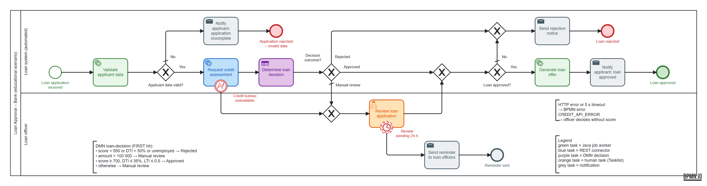
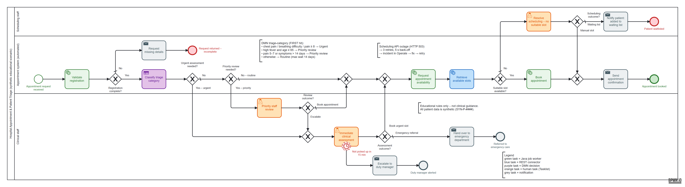

# PBJ-2 Practical Assignment – Camunda 8: End-to-End Workflow Automation (Labs 1–3)

Three separate workflow implementations on **Camunda 8** (Zeebe, Operate, Tasklist, Connectors). Each one has a BPMN
process, a DMN decision table, Tasklist forms, a **Java / Spring Boot** job-worker application with a mock REST API, a
**REST Outbound Connector**, test scenarios executed against the running engine, and real Operate/Tasklist screenshots,
including incident investigation and recovery.

| Lab | Process | Report | Scenarios |
|---|---|---|---|
| 1 – Loan approval | `loan-approval` + DMN `loan-decision` | [lab1-loan-approval/REPORT.md](lab1-loan-approval/REPORT.md) | 10 / 10 PASS |
| 2 – E-commerce order fulfilment | `order-fulfilment` + DMN `order-priority` | [lab2-order-fulfilment/REPORT.md](lab2-order-fulfilment/REPORT.md) | 8 / 8 PASS |
| 3 – Hospital appointment & triage | `patient-appointment-triage` + DMN `triage-category` | [lab3-hospital-triage/REPORT.md](lab3-hospital-triage/REPORT.md) | 8 / 8 PASS |

All data is **synthetic**. There are no real payment credentials, secrets or patient data, and the decision rules are educational.

## Results of all experiments

Every experiment below was executed against the running Camunda 8 Run 8.8 engine (Zeebe, Operate, Tasklist,
Connectors) on this machine. The tables are generated from each lab's `evidence/run-log.json`, so the **outputs are the
actual process variables** read back from the engine after each instance finished, not expected values.

| | Experiments | Passed | Human tasks | Incidents caused and recovered | DMN sample evaluations | Unit tests |
|---|---|---|---|---|---|---|
| Lab 1 | 10 | 10 | 4 (1 completed in the Tasklist UI) | 2 | 7 | 3 / 3 |
| Lab 2 | 8 | 8 | 2 (1 completed in the Tasklist UI) | 2 | 7 | 6 / 6 |
| Lab 3 | 8 | 8 | 7 (2 completed in the Tasklist UI) | 1 | 9 | 8 / 8 |
| **Total** | **26** | **26** | **13** | **5** | **23** | **17 / 17** |

How to read the tables: *Actual end event* is where the instance finished. *Output* lists the key variables produced
on the way (validation result, connector response, DMN result, human decision, final status). For failure experiments
it starts with the incident Operate showed, which was then fixed and retried.

### Lab 1 – Loan approval

**What it does:** a Java worker validates the application and computes affordability ratios. The REST Connector asks a
mock credit bureau for a score, and the DMN `loan-decision` returns Approved, Rejected or Manual review. Borderline or
large loans go to a loan officer in Tasklist. If the bureau fails or times out, a BPMN error boundary sends the case
straight to the officer.

**What the experiments show:**
- Strong applicants are approved automatically (DMN rule LD-5).
- Weak ones are rejected by the matching rule: LD-1 low score, LD-2 debt ratio.
- Borderline (LD-6) and large (LD-4) loans wait for the officer, and the officer's decision is what counts.
- Credit-bureau errors (HTTP 500) and timeouts (HTTP 408) do not break the process; they become manual reviews.
- The two worker failures (a broken dependency, and a text value in a number field) appear as incidents in Operate. After the cause was fixed, they finished normally.



<!-- RESULTS:lab1:BEGIN -->
| ID | Experiment | Actual end event | Output (real process variables) | Status |
|---|---|---|---|---|
| L1-01 | Strong applicant is approved automatically | LoanApproved | score 762 (band A) · DTI 0.1482 · DMN LD-5 → APPROVED · final **APPROVED** by AUTOMATED (DMN) · offer OFF-LA-2026-0001 at 6.5% | **PASS** |
| L1-02 | Low credit score is rejected by the DMN | LoanRejected | score 512 (band E) · DTI 0.2678 · DMN LD-1 → REJECTED · final **REJECTED** by AUTOMATED (DMN) | **PASS** |
| L1-03 | Borderline score goes to manual review, officer approves in Tasklist | LoanApproved | score 648 (band D) · DTI 0.2668 · DMN LD-6 → MANUAL_REVIEW · final **APPROVED** by LOAN OFFICER · offer OFF-LA-2026-0003 at 11.9% | **PASS** |
| L1-04 | Loan above 100 000 goes to manual review, officer rejects | LoanRejected | score 731 (band B) · DTI 0.16 · DMN LD-4 → MANUAL_REVIEW · final **REJECTED** by LOAN OFFICER | **PASS** |
| L1-05 | Missing e-mail and under-age applicant fail validation | InvalidData | validation failed: email is required; age must be between 18 and 75 (was 16) | **PASS** |
| L1-06 | Credit bureau returns HTTP 500 -> manual review -> officer approves | LoanApproved | credit check UNAVAILABLE (HTTP 500: Internal scoring engine error) · DTI 0.1595 · final **APPROVED** by LOAN OFFICER · offer OFF-LA-2026-0006 at 10.9% | **PASS** |
| L1-07 | Credit bureau times out (8 s > 5 s limit) -> manual review -> officer rejects | LoanRejected | credit check UNAVAILABLE (HTTP 408: The request timed out. Please try increasing the read and connection timeouts.) · DTI 0.3845 · final **REJECTED** by LOAN OFFICER | **PASS** |
| L1-08 | Validation worker dependency down -> incident -> repaired -> retried -> approved | LoanApproved | incident `JOB_NO_RETRIES` on `Task_ValidateApplicant`: “Validation reference-data service unavailable (connection refused). Fix: restore the service (POST /admin/f…” → fixed, retried → score 705 (band B) · DTI 0.0997 · DMN LD-5 → APPROVED · final **APPROVED** by AUTOMATED (DMN) · offer OFF-LA-2026-0008 at 7.9% | **PASS** |
| L1-09 | Non-numeric income -> incident -> variable corrected -> retried -> approved | LoanApproved | incident `JOB_NO_RETRIES` on `Task_ValidateApplicant`: “Variable 'monthlyIncome' must be numeric but was the String "five thousand". Correct the variable in Operat…” → fixed, retried → score 744 (band B) · DTI 0.11 · DMN LD-5 → APPROVED · final **APPROVED** by AUTOMATED (DMN) · offer OFF-LA-2026-0009 at 7.9% | **PASS** |
| L1-10 | Debt-to-income above 50% is rejected by the DMN | LoanRejected | score 762 (band A) · DTI 0.559 · DMN LD-2 → REJECTED · final **REJECTED** by AUTOMATED (DMN) | **PASS** |

**10 / 10 passed.** Instance keys, every action taken and all variables: [`lab1-loan-approval/evidence/run-log.json`](lab1-loan-approval/evidence/run-log.json).
<!-- RESULTS:lab1:END -->

### Lab 2 – E-commerce order processing and fulfilment

**What it does:**
1. Java workers validate the order, check and **reserve** stock, and calculate the total.
2. The DMN `order-priority` sets the delivery priority and SLA.
3. Orders of 2 000 EUR or more, or orders of 1 000 EUR or more from NEW customers, need a reviewer in Tasklist.
4. The REST Connector charges a mock payment gateway with test tokens.
5. If the payment is approved, the order goes to fulfilment. If it is declined or the reviewer rejects it, the reserved stock is released (compensation).

**What the experiments show:**
- A normal order is paid and shipped.
- An out-of-stock order stops before payment.
- A declined payment releases the stock.
- A high-value order is approved by the reviewer, while a NEW-customer order is rejected and its stock released.
- An invalid product is rejected at validation.
- A payment-gateway outage (HTTP 503) and an inventory outage each become an incident. After the service was restored and the job retried, the order was fulfilled.


<!-- RESULTS:lab2:BEGIN -->
| ID | Experiment | Actual end event | Output (real process variables) | Status |
|---|---|---|---|---|
| L2-01 | Stock available and payment approved | OrderFulfilled | customer REGULAR · stock AVAILABLE · total 215.76 EUR · DMN priority LOW (96 h) · payment **APPROVED** · stock COMMITTED · shipment SHP-ORD-2001 | **PASS** |
| L2-02 | Stock insufficient – order cannot proceed to fulfilment | OutOfStock | customer REGULAR · stock INSUFFICIENT | **PASS** |
| L2-03 | Payment declined by the mock gateway | PaymentDeclined | customer REGULAR · stock AVAILABLE · total 553.79 EUR · DMN priority HIGH (24 h) · payment **DECLINED** (Insufficient funds) · stock RELEASED | **PASS** |
| L2-04 | High-value order routed to manual verification – reviewer approves | OrderFulfilled | customer VIP · stock AVAILABLE · total 2080.91 EUR · DMN priority CRITICAL (8 h) · reviewer APPROVED · payment **APPROVED** · stock COMMITTED · shipment SHP-ORD-2004 | **PASS** |
| L2-05 | NEW customer exception order – reviewer rejects | CancelledByReviewer | customer NEW · stock AVAILABLE · total 1077.6 EUR · DMN priority NORMAL (48 h) · reviewer REJECTED · stock RELEASED | **PASS** |
| L2-06 | Invalid product ID – order rejected by validation | OrderRejected | validation failed: productId PRD-9999 does not exist in the catalogue | **PASS** |
| L2-07 | Payment gateway outage → incident → gateway restored → retry → fulfilled | OrderFulfilled | incident `JOB_NO_RETRIES` on `Task_ProcessPayment`: “HTTP 503: Payment gateway temporarily unavailable” → fixed, retried → customer REGULAR · stock AVAILABLE · total 409.79 EUR · DMN priority HIGH (24 h) · payment **APPROVED** · stock COMMITTED · shipment SHP-ORD-2007 | **PASS** |
| L2-08 | Inventory service outage → incident → service restored → retry → fulfilled | OrderFulfilled | incident `JOB_NO_RETRIES` on `Task_CheckInventory`: “Inventory service unavailable (HTTP 503 from inventory-api). Fix: restore the service (POST /admin/faults/i…” → fixed, retried → customer VIP · stock AVAILABLE · total 291.28 EUR · DMN priority HIGH (24 h) · payment **APPROVED** · stock COMMITTED · shipment SHP-ORD-2008 | **PASS** |

**8 / 8 passed.** Instance keys, every action taken and all variables: [`lab2-order-fulfilment/evidence/run-log.json`](lab2-order-fulfilment/evidence/run-log.json).
<!-- RESULTS:lab2:END -->

### Lab 3 – Hospital appointment and patient triage

**What it does:**
1. A Java worker validates the registration.
2. The DMN `triage-category` classifies the request as Routine, Priority Review or Urgent Assessment (educational rules, not clinical guidance).
3. Urgent cases go to immediate clinical assessment in Tasklist, with a 15-minute escalation timer; priority cases go to staff review.
4. A worker registers an availability request, and the REST Connector retrieves free slots from a mock scheduling API.
5. If a slot is found, it is booked. If none is suitable, scheduling staff decide between a manual slot and the waiting list.

**What the experiments show:**
- A routine request books the first free slot.
- Moderate pain gets a priority review, then a booking within 3 days.
- Chest pain gets immediate assessment and an emergency referral.
- Dermatology has no slots, so staff waitlist the patient (L3-04) or assign a manual slot (L3-08).
- A priority case escalated by staff becomes urgent and gets a same-day slot (L3-07).
- An incomplete registration is returned.
- A scheduling-API outage (HTTP 503) becomes an incident. It recovered after the API was restored and the job retried.



<!-- RESULTS:lab3:BEGIN -->
| ID | Experiment | Actual end event | Output (real process variables) | Status |
|---|---|---|---|---|
| L3-01 | Routine request with an available slot | AppointmentBooked | DMN **ROUTINE** (No urgency indicators present, max wait 14 d) · 5 slots found · booking **CONFIRMED** BK-5CEF5D6A · 2026-11-03 08:00 - GENERAL_PRACTICE | **PASS** |
| L3-02 | Moderate pain routed to priority staff review, staff books | AppointmentBooked | DMN **PRIORITY_REVIEW** (Moderate pain (5-7 out of 10), max wait 3 d) · staff review: BOOK_APPOINTMENT · 5 slots found · booking **CONFIRMED** BK-91B41FFA · 2026-10-30 13:00 - ORTHOPAEDICS | **PASS** |
| L3-03 | Chest pain routed to immediate clinical assessment, referred to ED | EmergencyReferral | DMN **URGENT_ASSESSMENT** (Chest pain reported, max wait 0 d) · clinical assessment: EMERGENCY_REFERRAL | **PASS** |
| L3-04 | No appointment slot available (DERMATOLOGY), staff waitlists | Waitlisted | DMN **ROUTINE** (No urgency indicators present, max wait 14 d) · scheduling staff: WAITLIST · 0 slots found · booking **WAITLISTED** | **PASS** |
| L3-05 | Incomplete registration returned to patient | RequestIncomplete | registration incomplete: patientReference is required; painLevel is required | **PASS** |
| L3-06 | Scheduling API fails → incident → fault repaired → retried → booked | AppointmentBooked | incident `JOB_NO_RETRIES` on `Task_RetrieveSlots`: “HTTP 503: Scheduling service temporarily unavailable” → fixed, retried → DMN **ROUTINE** (No urgency indicators present, max wait 14 d) · 5 slots found · booking **CONFIRMED** BK-90450D53 · 2026-11-03 08:00 - RESPIRATORY | **PASS** |
| L3-07 | Priority review escalated to urgent, urgent same-day slot booked | AppointmentBooked | DMN: High fever in patient aged 65 or over → staff escalated to **URGENT_ASSESSMENT** (max wait 0 d) · staff review: ESCALATE_URGENT · clinical assessment: BOOK_URGENT_SLOT · 5 slots found · booking **CONFIRMED** BK-AF9002CE · 2026-10-30 08:00 - GENERAL_PRACTICE | **PASS** |
| L3-08 | No slot available, scheduling staff assigns a manual slot | AppointmentBooked | DMN **PRIORITY_REVIEW** (Symptoms persisting for more than 14 days, max wait 5 d) · staff review: BOOK_APPOINTMENT · scheduling staff: MANUAL_SLOT · 0 slots found · booking **CONFIRMED_MANUAL** · 2026-11-05 15:00 - Dermatology extra clinic | **PASS** |

**8 / 8 passed.** Instance keys, every action taken and all variables: [`lab3-hospital-triage/evidence/run-log.json`](lab3-hospital-triage/evidence/run-log.json).
<!-- RESULTS:lab3:END -->

### Other outputs

- **DMN sample evaluations:** every rule of every decision table was evaluated against the *deployed* decision:
  [Lab 1](lab1-loan-approval/docs/dmn-sample-evaluations.md) · [Lab 2](lab2-order-fulfilment/docs/dmn-sample-evaluations.md) ·
  [Lab 3](lab3-hospital-triage/docs/dmn-sample-evaluations.md). Each set includes a FIRST-hit precedence case.
- **Unit tests** (`mvn test`, all passing):

  | Test class | Tests | Checks |
  |---|---|---|
  | `ApplicantValidatorTest` (Lab 1) | 3 | valid application + ratio maths, collection of all validation errors, malformed (non-numeric) variable |
  | `OrderPricingTest` (Lab 2) | 3 | free shipping above 100 EUR, VIP 10% discount + same-day fee, small order pays shipping (incl. VAT) |
  | `OrderValidatorAndInventoryTest` (Lab 2) | 3 | valid order enriched with customer + product, unknown product / bad quantity reported, reservation reduces stock and release restores it |
  | `RegistrationValidatorTest` (Lab 3) | 4 | required fields, ranges and formats of a registration |
  | `SearchWindowTest` (Lab 3) | 4 | appointment search window from max wait days and preferred date |

- **REST examples:** real requests and responses captured from the mock APIs are in each lab's `api-examples/` folder.
- **Screenshots:** each lab's `evidence/screenshots/` folder and the gallery at the end of each `REPORT.md`.

## Repository layout

```
├── pom.xml                         Maven parent (Java 21, Spring Boot 3.5.16, Camunda starter 8.8.32)
├── lab1-loan-approval/             ┐
├── lab2-order-fulfilment/          │  each lab:
├── lab3-hospital-triage/           ┘   src/main/resources/models/  BPMN, DMN, forms (deployed on start-up)
│                                       src/main/java/...           job workers, mock REST API, fault injection
│                                       src/test/java/...           unit tests
│                                       test-data/                  one JSON file per test scenario
│                                       api-examples/               real REST request/response samples
│                                       docs/                       DMN rules + real sample evaluations
│                                       evidence/                   run-log.json, test-results.md, screenshots/
│                                       REPORT.md                   implementation report
├── scripts/
│   ├── bpmn/                       diagram generators (grid layout → readable BPMN/DMN)
│   ├── c8.py                       small CLI for the Camunda REST API (start, tasks, incidents, retry, evaluate)
│   ├── run_scenarios.py            runs a lab's scenarios and records the real outcomes
│   ├── report_assets.py            fills each REPORT.md's results table and screenshot gallery from the evidence
│   ├── scenarios/                  Lab 1 scenario generator
│   └── render/                     bpmn-js / dmn-js renderer and the Operate/Tasklist screenshot tool (Node)
├── docs/
│   ├── environment.md              versions, ports, how Camunda 8 Run was started
│   └── bpmn-style-guide.md         the readability rules all diagrams follow
```

## Prerequisites

- Camunda 8 Run 8.8 (we used the copy bundled with Camunda Modeler 5.49: `c8run\start-c8run.bat`)
- JDK 21+ and Maven 3.9+
- Python 3.10+ (test runner, no extra packages)
- Optional, for re-capturing evidence: Node 20+ and Microsoft Edge (`cd scripts/render && npm install`)

## Quick start

```bash
# 1. Camunda 8 Run must be running (Operate: http://localhost:8080/operate)
# 2. Build and unit-test all labs
mvn test
# 3. Start one lab app (deploys its BPMN/DMN/forms and starts workers + mock API)
mvn -pl lab1-loan-approval spring-boot:run
# 4. In another terminal: run that lab's scenarios against the engine
python scripts/run_scenarios.py lab1-loan-approval
# (add --screenshots to re-capture Operate/Tasklist evidence)
```

Lab 2 uses port 8082 and Lab 3 uses port 8083; all three apps can run at the same time.

## Coverage of the common submission checklist

| Checklist item | Lab 1 | Lab 2 | Lab 3 |
|---|---|---|---|
| BPMN model + design screenshot | `models/loan-approval.bpmn`, `01-bpmn-design.png` | `models/order-fulfilment.bpmn`, `01-…` | `models/patient-appointment-triage.bpmn`, `01-…` |
| DMN model, rules, sample results | `loan-decision.dmn`, `docs/` | `order-priority.dmn`, `docs/` | `triage-category.dmn`, `docs/` |
| Worker source + run instructions | `src/main/java`, REPORT §8 | REPORT §8 | REPORT §9 |
| REST Connector config + API examples | REPORT §4, `api-examples/` | REPORT §5, `api-examples/` | REPORT §5–6, `api-examples/` |
| Process-variable dictionary | REPORT §5 | REPORT §6 | REPORT §7 |
| Tests: success, rejection, manual review, failure/recovery | REPORT §6 | REPORT §7 | REPORT §8 |
| Deployment + execution evidence | `03-…`, `04-…` screenshots, `run-log.json` | same | same |
| Tasklist evidence | `05-…`, `06-…` (completed in the UI) | same | same |
| Operate monitoring + incident resolution | `07-…`–`10-…` | same | same |
| Short report | `REPORT.md` | `REPORT.md` | `REPORT.md` |
