# PBJ-2 Camunda 8 – Labs 1 to 3

Three workflows built on **Camunda 8** (Zeebe, Operate, Tasklist, Connectors). Each lab has a BPMN process, a DMN
table, a Tasklist form, a **Spring Boot** job-worker app with a mock REST API, and a **REST Connector**. Every test
was run on a real Camunda 8 Run engine, and all screenshots come from those runs. All data is **synthetic**.

| Lab | Process | Tests | Full report |
|---|---|---|---|
| 1 – Loan approval | `loan-approval` + DMN `loan-decision` | 17 / 17 PASS | [REPORT.md](lab1-loan-approval/REPORT.md) |
| 2 – Order fulfilment | `order-fulfilment` + DMN `order-priority` | 12 / 12 PASS | [REPORT.md](lab2-order-fulfilment/REPORT.md) |
| 3 – Hospital triage | `patient-appointment-triage` + DMN `triage-category` | 12 / 12 PASS | [REPORT.md](lab3-hospital-triage/REPORT.md) |

Click any picture to open it at full size.

## Lab 1 – Loan approval

**How it works**
1. A Java worker **validates** the application. If details are missing, the applicant is asked for them (closed after 7 days with no reply).
2. The REST Connector gets a **credit score** from the primary bureau. If it is down, the **backup bureau** is used. If both are down, an officer decides without a score.
3. The **DMN** decides: *Approved*, *Rejected* or *Manual review* (first matching rule wins).
4. **Manual review** is done by a loan officer in Tasklist: a reminder is sent after 24 h, and the task is escalated after 48 h.
5. The applicant must **accept the offer** within 14 days, then the loan is paid out.

**REST API:** `POST http://localhost:8081/mock/credit-bureau/primary/assessments` (backup: `/backup/assessments`) · examples in [`api-examples/`](lab1-loan-approval/api-examples/)

[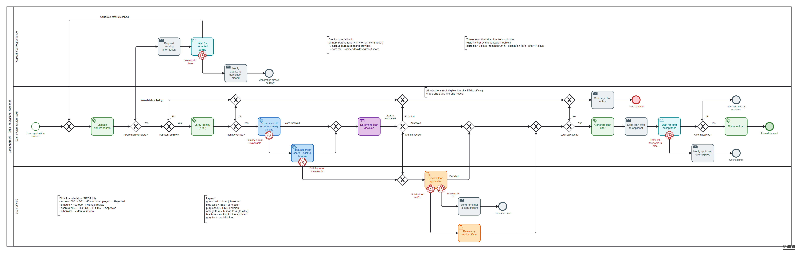](lab1-loan-approval/evidence/screenshots/01-bpmn-design.png)

<table>
<tr><th>DMN decision table</th><th>Tasklist form (loan review)</th></tr>
<tr><td width="60%"><a href="lab1-loan-approval/evidence/screenshots/02-dmn-decision-table.png">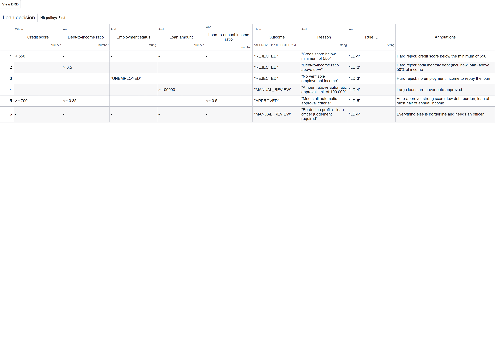</a></td><td width="40%"><a href="lab1-loan-approval/evidence/screenshots/06-tasklist-task-form.png">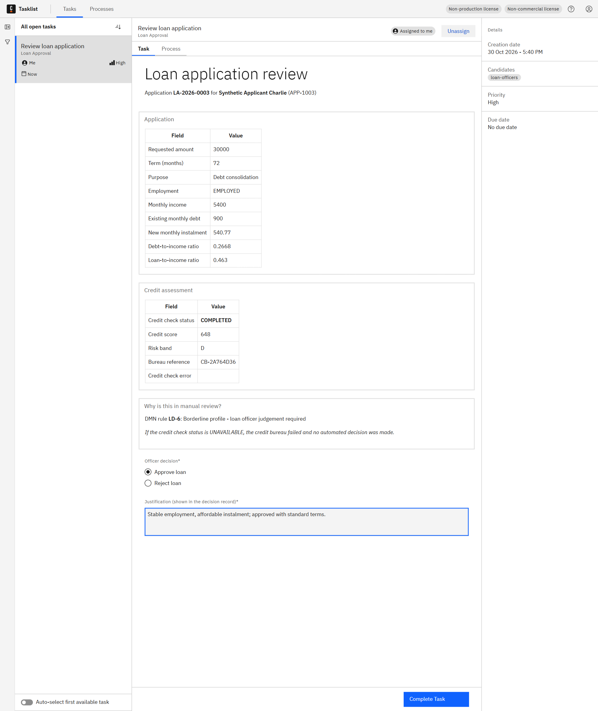</a></td></tr>
<tr><th>Operate – incident raised</th><th>Operate – same instance after fix + retry</th></tr>
<tr><td><a href="lab1-loan-approval/evidence/screenshots/07-operate-incident-L1-09.png">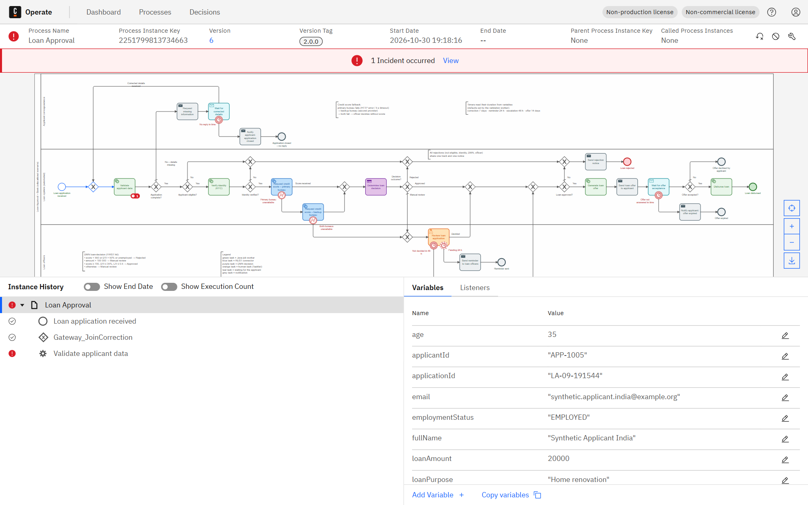</a></td><td><a href="lab1-loan-approval/evidence/screenshots/09-operate-recovered-L1-09.png">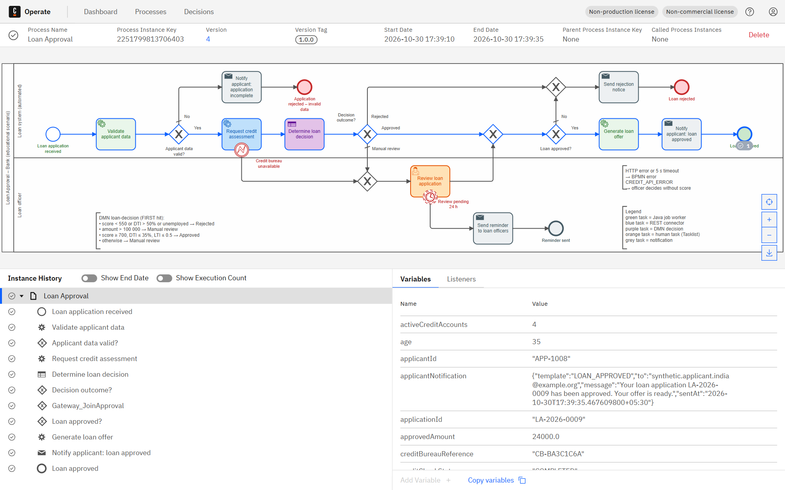</a></td></tr>
</table>

## Lab 2 – E-commerce order fulfilment

**How it works**
1. Java workers **validate** the order and **reserve stock**, using the secondary warehouse if the primary one is short. Then they calculate the total.
2. The **DMN** sets the delivery priority and SLA.
3. Orders of 2 000 EUR or more (1 000 EUR or more for new customers) need a **reviewer** in Tasklist.
4. The REST Connector **charges the payment** with the primary provider, or the **backup provider** if the primary is down. If the card is declined, the customer can send another payment method.
5. The shipment is booked, using the backup carrier if needed. Every cancellation **releases the stock**.

**REST API:** `POST http://localhost:8082/mock/payment-gateway/primary/charges` (backup: `/backup/charges`) · examples in [`api-examples/`](lab2-order-fulfilment/api-examples/)

[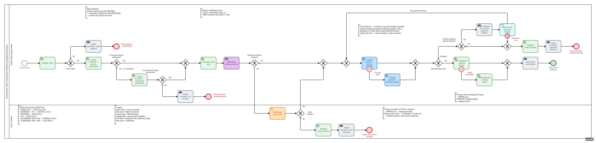](lab2-order-fulfilment/evidence/screenshots/01-bpmn-design.png)

<table>
<tr><th>DMN decision table</th><th>Tasklist form (order verification)</th></tr>
<tr><td width="60%"><a href="lab2-order-fulfilment/evidence/screenshots/02-dmn-decision-table.png">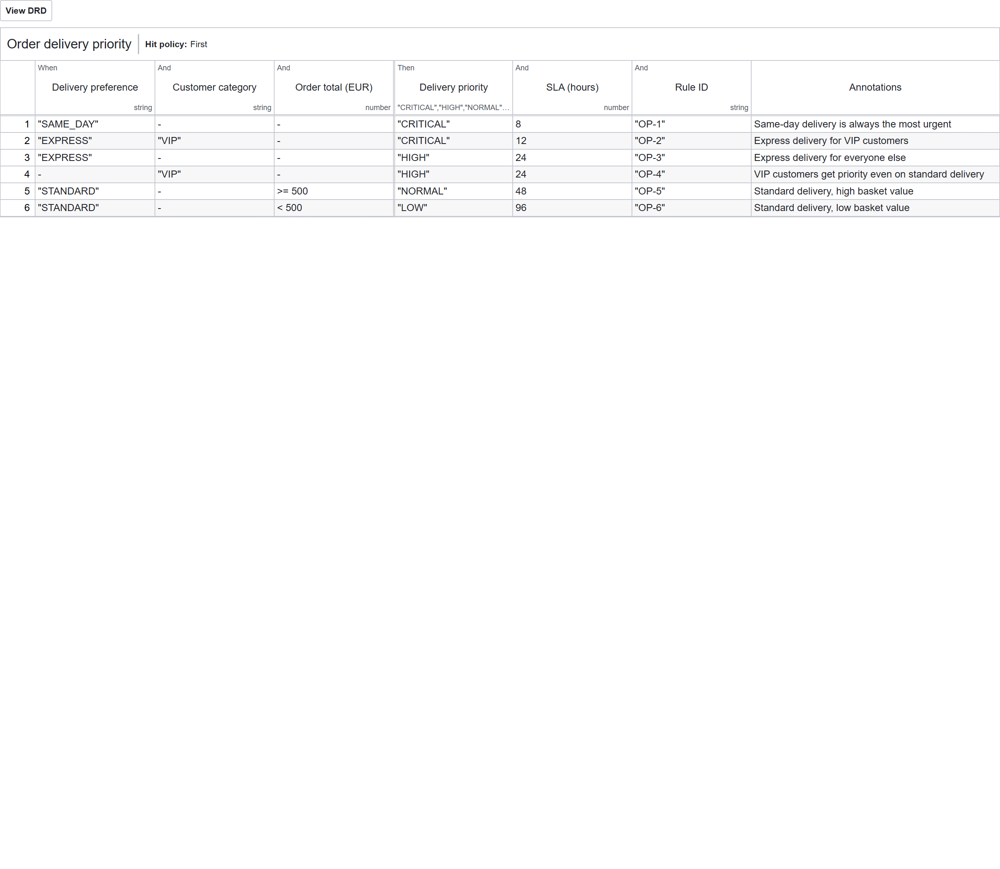</a></td><td width="40%"><a href="lab2-order-fulfilment/evidence/screenshots/06-tasklist-task-form.png">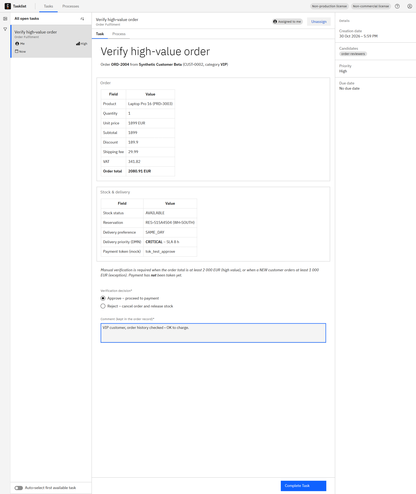</a></td></tr>
<tr><th>Operate – incident raised</th><th>Operate – same instance after fix + retry</th></tr>
<tr><td><a href="lab2-order-fulfilment/evidence/screenshots/07-operate-incident-L2-07.png">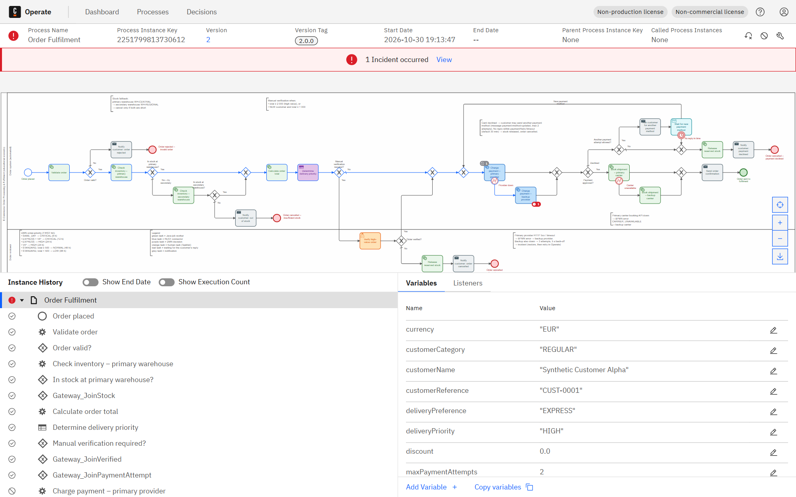</a></td><td><a href="lab2-order-fulfilment/evidence/screenshots/09-operate-recovered-L2-07.png">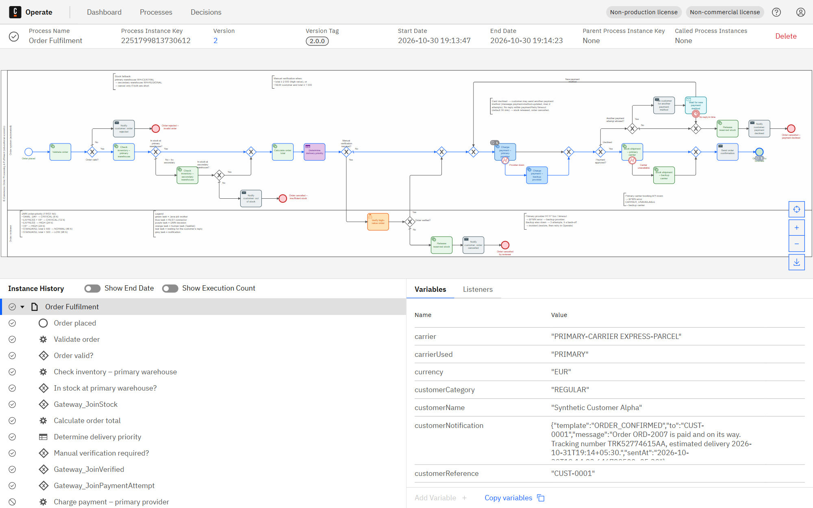</a></td></tr>
</table>

## Lab 3 – Hospital appointment and triage

**How it works**
1. A Java worker **validates** the registration.
2. The **DMN** sorts the request into *Routine*, *Priority review* or *Urgent assessment* (educational rules, not medical advice).
3. **Urgent** cases go to a clinician in Tasklist, and the duty manager is alerted if nobody picks them up. **Priority** cases go to a staff review.
4. The REST Connector **finds free slots** at the main hospital, or at the **partner clinic** if the hospital has none. If a slot is taken while booking, it searches again.
5. The patient must **confirm**: a reminder is sent, and unconfirmed slots are released.

**REST API:** `GET http://localhost:8083/mock/scheduling/availability-requests/{id}/slots?site=MAIN_HOSPITAL` (or `PARTNER_CLINIC`) · examples in [`api-examples/`](lab3-hospital-triage/api-examples/)

[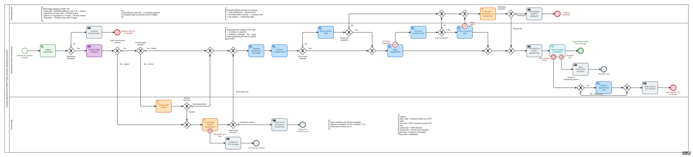](lab3-hospital-triage/evidence/screenshots/01-bpmn-design.png)

<table>
<tr><th>DMN decision table</th><th>Tasklist form (priority review)</th></tr>
<tr><td width="60%"><a href="lab3-hospital-triage/evidence/screenshots/02-dmn-decision-table.png">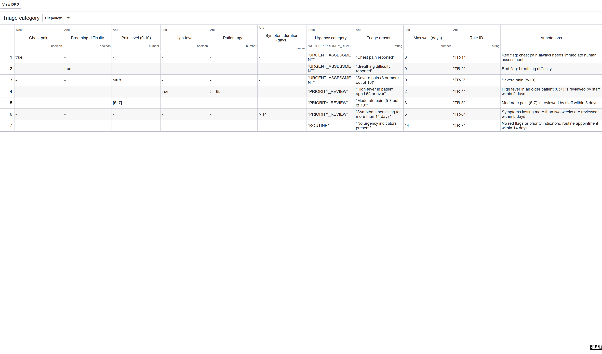</a></td><td width="40%"><a href="lab3-hospital-triage/evidence/screenshots/06-tasklist-task-form-priority-review.png">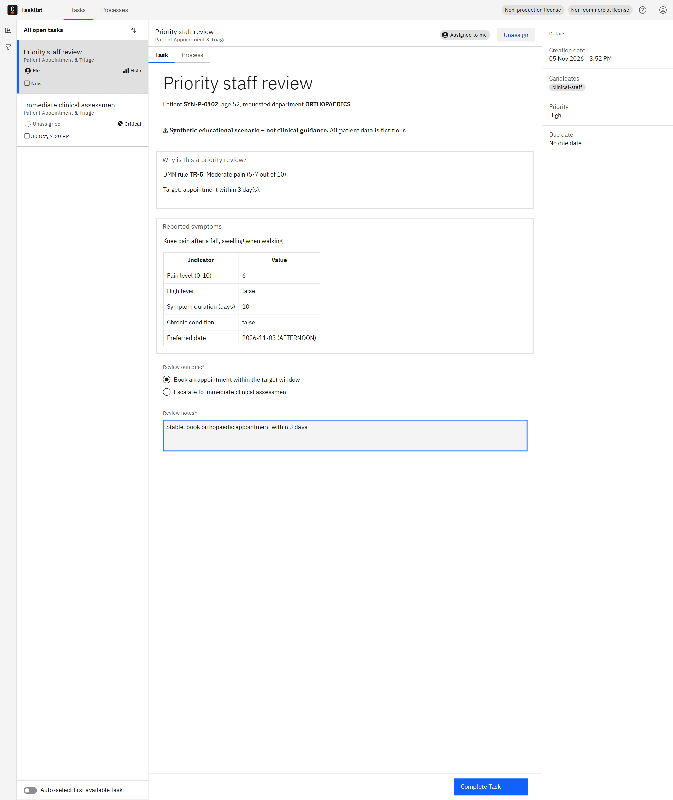</a></td></tr>
<tr><th>Operate – incident raised</th><th>Operate – same instance after fix + retry</th></tr>
<tr><td><a href="lab3-hospital-triage/evidence/screenshots/07-operate-incident.png">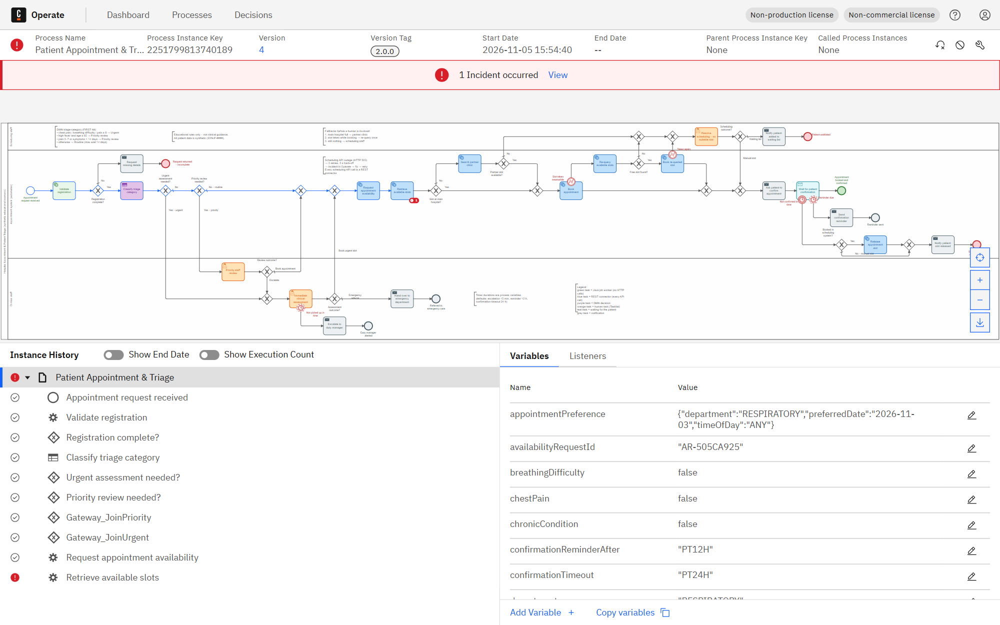</a></td><td><a href="lab3-hospital-triage/evidence/screenshots/09-operate-recovered.png">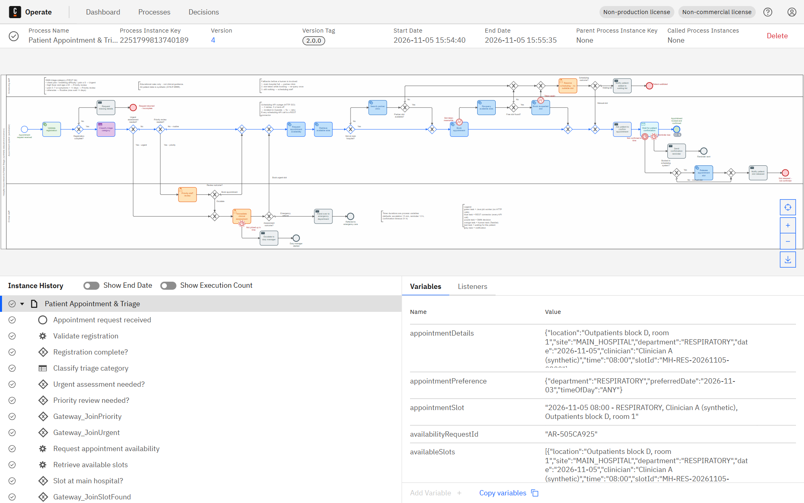</a></td></tr>
</table>

## Results

| | Tests | Passed | Human tasks | Incidents fixed | Unit tests |
|---|---|---|---|---|---|
| Lab 1 | 17 | 17 | 4 | 2 | 4 / 4 |
| Lab 2 | 12 | 12 | 2 | 2 | 9 / 9 |
| Lab 3 | 12 | 12 | 8 | 1 | 13 / 13 |
| **Total** | **41** | **41** | **14** | **5** | **26 / 26** |

The outputs below are the real process variables read back from the engine after each run. For failure tests, the
output starts with the incident shown in Operate, which was then fixed and retried.

<details>
<summary><b>Lab 1 – all 17 test outputs</b></summary>

<!-- RESULTS:lab1:BEGIN -->
| ID | Experiment | Actual end event | Output (real process variables) | Status |
|---|---|---|---|---|
| L1-01 | Strong applicant: auto-approved, offer accepted, loan disbursed | LoanDisbursed | score 762 (band A) from **PRIMARY** bureau · DTI 0.1482 · DMN LD-5 → APPROVED · final **APPROVED** by AUTOMATED (DMN) · offer OFF-LA-01-191544 at 6.5% · offer accepted · disbursed DSB-59B4867F | **PASS** |
| L1-02 | Low credit score is rejected by the DMN | LoanRejected | score 512 (band E) from **PRIMARY** bureau · DTI 0.2678 · DMN LD-1 → REJECTED · final **REJECTED** by AUTOMATED (DMN) | **PASS** |
| L1-03 | Borderline score: officer approves in Tasklist, offer accepted | LoanDisbursed | score 648 (band D) from **PRIMARY** bureau · DTI 0.2668 · DMN LD-6 → MANUAL_REVIEW · final **APPROVED** by LOAN OFFICER · offer OFF-LA-03-191544 at 11.9% · offer accepted · disbursed DSB-8D5112F8 | **PASS** |
| L1-04 | Loan above 100 000 goes to manual review, officer rejects | LoanRejected | score 731 (band B) from **PRIMARY** bureau · DTI 0.16 · DMN LD-4 → MANUAL_REVIEW · final **REJECTED** by LOAN OFFICER | **PASS** |
| L1-05 | Under-age applicant is not eligible: rejected without credit check | LoanRejected | rejected – Not eligible: age must be between 18 and 75 (was 16) | **PASS** |
| L1-06 | Primary bureau returns HTTP 500 -> score taken from the backup bureau -> approved | LoanDisbursed | primary bureau failed (HTTP 500: Internal scoring engine error) · score 741 (band B) from **BACKUP** bureau · DTI 0.1595 · DMN LD-5 → APPROVED · final **APPROVED** by AUTOMATED (DMN) · offer OFF-LA-06-191544 at 7.9% · offer accepted · disbursed DSB-C02FD55B | **PASS** |
| L1-07 | Primary bureau times out (8 s > 5 s) -> backup bureau -> approved | LoanDisbursed | primary bureau failed (HTTP 408: The request timed out. Please try increasing the read and connection timeouts.) · score 726 (band B) from **BACKUP** bureau · DTI 0.1228 · DMN LD-5 → APPROVED · final **APPROVED** by AUTOMATED (DMN) · offer OFF-LA-07-191544 at 7.9% · offer accepted · disbursed DSB-DF439B20 | **PASS** |
| L1-08 | Both credit bureaus down -> loan officer decides without a score -> approves | LoanDisbursed | primary bureau failed (HTTP 503: Primary credit bureau temporarily unavailable) · backup bureau failed too (HTTP 503: Backup credit bureau temporarily unavailable) → no score · DTI 0.1425 · final **APPROVED** by LOAN OFFICER · offer OFF-LA-08-191544 at 10.9% · offer accepted · disbursed DSB-75CE93F2 | **PASS** |
| L1-09 | Validation worker dependency down -> incident -> repaired -> retried -> disbursed | LoanDisbursed | incident `JOB_NO_RETRIES` on `Task_ValidateApplicant`: “Validation reference-data service unavailable (connection refused). Fix: restore the service (POST /admin/f…” → fixed, retried → score 705 (band B) from **PRIMARY** bureau · DTI 0.0997 · DMN LD-5 → APPROVED · final **APPROVED** by AUTOMATED (DMN) · offer OFF-LA-09-191544 at 7.9% · offer accepted · disbursed DSB-D2CDC0F4 | **PASS** |
| L1-10 | Non-numeric income -> incident -> variable corrected in place -> retried -> disbursed | LoanDisbursed | incident `JOB_NO_RETRIES` on `Task_ValidateApplicant`: “Variable 'monthlyIncome' must be numeric but was the String "five thousand". Correct the variable in Operat…” → fixed, retried → score 744 (band B) from **PRIMARY** bureau · DTI 0.11 · DMN LD-5 → APPROVED · final **APPROVED** by AUTOMATED (DMN) · offer OFF-LA-10-191544 at 7.9% · offer accepted · disbursed DSB-9040F878 | **PASS** |
| L1-11 | Missing e-mail -> applicant asked for details -> sends them -> re-validated -> disbursed | LoanDisbursed | score 762 (band A) from **PRIMARY** bureau · DTI 0.1482 · DMN LD-5 → APPROVED · final **APPROVED** by AUTOMATED (DMN) · offer OFF-LA-11-191544 at 6.5% · offer accepted · disbursed DSB-872282C1 | **PASS** |
| L1-12 | Missing e-mail, applicant never replies -> correction window expires -> application closed | ApplicationClosed | incomplete: email is required → applicant did not reply | **PASS** |
| L1-13 | Identity cannot be verified (watch-list hit) -> rejected | LoanRejected | rejected – Identity could not be verified (document mismatch / watch-list hit) | **PASS** |
| L1-14 | Officer does not act -> reminder after 24 h -> escalated to a senior officer after 48 h -> approved | ReminderSent, LoanDisbursed | score 648 (band D) from **PRIMARY** bureau · DTI 0.2668 · DMN LD-6 → MANUAL_REVIEW · final **APPROVED** by SENIOR LOAN OFFICER (escalated) · offer OFF-LA-14-191544 at 11.9% · offer accepted · disbursed DSB-725D0867 | **PASS** |
| L1-15 | Approved, but the applicant never answers the offer -> offer expires | OfferExpired | score 762 (band A) from **PRIMARY** bureau · DTI 0.1482 · DMN LD-5 → APPROVED · final **APPROVED** by AUTOMATED (DMN) · offer OFF-LA-15-191544 at 6.5% | **PASS** |
| L1-16 | Approved, but the applicant declines the offer | OfferDeclined | score 762 (band A) from **PRIMARY** bureau · DTI 0.1482 · DMN LD-5 → APPROVED · final **APPROVED** by AUTOMATED (DMN) · offer OFF-LA-16-191544 at 6.5% · offer **declined** | **PASS** |
| L1-17 | Debt-to-income above 50% is rejected by the DMN | LoanRejected | score 762 (band A) from **PRIMARY** bureau · DTI 0.559 · DMN LD-2 → REJECTED · final **REJECTED** by AUTOMATED (DMN) | **PASS** |

**17 / 17 passed.** Instance keys, every action taken and all variables: [`lab1-loan-approval/evidence/run-log.json`](lab1-loan-approval/evidence/run-log.json).
<!-- RESULTS:lab1:END -->

</details>

<details>
<summary><b>Lab 2 – all 12 test outputs</b></summary>

<!-- RESULTS:lab2:BEGIN -->
| ID | Experiment | Actual end event | Output (real process variables) | Status |
|---|---|---|---|---|
| L2-01 | Stock available and payment approved | OrderFulfilled | customer REGULAR · stock AVAILABLE · total 215.76 EUR · DMN priority LOW (96 h) · payment **APPROVED** by primary provider · stock COMMITTED · shipment SHP-ORD-2001 | **PASS** |
| L2-02 | Both warehouses short – order cannot proceed to fulfilment | OutOfStock | customer REGULAR · stock INSUFFICIENT | **PASS** |
| L2-03 | Payment declined, customer does not send a new payment method in time | PaymentDeclined | customer REGULAR · stock AVAILABLE · total 553.79 EUR · DMN priority HIGH (24 h) · payment **DECLINED** (Insufficient funds) by primary provider · payment attempt 2 · stock RELEASED | **PASS** |
| L2-04 | High-value order routed to manual verification – reviewer approves in Tasklist | OrderFulfilled | customer VIP · stock AVAILABLE · total 2080.91 EUR · DMN priority CRITICAL (8 h) · reviewer APPROVED · payment **APPROVED** by primary provider · stock COMMITTED · shipment SHP-ORD-2004 | **PASS** |
| L2-05 | NEW customer exception order – reviewer rejects | CancelledByReviewer | customer NEW · stock AVAILABLE · total 1077.6 EUR · DMN priority NORMAL (48 h) · reviewer REJECTED · stock RELEASED | **PASS** |
| L2-06 | Invalid product ID – order rejected by validation | OrderRejected | validation failed: productId PRD-9999 does not exist in the catalogue | **PASS** |
| L2-07 | Both payment providers down → incident → backup provider restored → retry → fulfilled | OrderFulfilled | incident `JOB_NO_RETRIES` on `Task_ChargeBackup`: “HTTP 503: Backup payment provider temporarily unavailable” → fixed, retried → customer REGULAR · stock AVAILABLE · total 409.79 EUR · DMN priority HIGH (24 h) · payment **APPROVED** by **BACKUP** provider · stock COMMITTED · shipment SHP-ORD-2007 | **PASS** |
| L2-08 | Inventory service outage → incident → service restored → retry → fulfilled | OrderFulfilled | incident `JOB_NO_RETRIES` on `Task_CheckPrimaryWarehouse`: “Inventory service unavailable (HTTP 503 from inventory-api). Fix: restore the service (POST /admin/faults/i…” → fixed, retried → customer VIP · stock AVAILABLE · total 291.28 EUR · DMN priority HIGH (24 h) · payment **APPROVED** by primary provider · stock COMMITTED · shipment SHP-ORD-2008 | **PASS** |
| L2-09 | Primary payment provider down → backup provider charges → fulfilled | OrderFulfilled | customer REGULAR · stock AVAILABLE · total 538.8 EUR · DMN priority NORMAL (48 h) · payment **APPROVED** by **BACKUP** provider · stock COMMITTED · shipment SHP-ORD-2009 | **PASS** |
| L2-10 | Primary warehouse sold out → secondary warehouse reserves → fulfilled | OrderFulfilled | customer REGULAR · stock AVAILABLE · reserved in **secondary warehouse** WH-REGIONAL · total 658.8 EUR · DMN priority NORMAL (48 h) · payment **APPROVED** by primary provider · stock COMMITTED · shipment SHP-ORD-2010 | **PASS** |
| L2-11 | Card declined → customer sends a new payment method → paid → fulfilled | OrderFulfilled | customer REGULAR · stock AVAILABLE · total 409.79 EUR · DMN priority HIGH (24 h) · payment **APPROVED** by primary provider · payment attempt 2 · stock COMMITTED · shipment SHP-ORD-2011 | **PASS** |
| L2-12 | Primary carrier booking API down → backup carrier → fulfilled | OrderFulfilled | customer VIP · stock AVAILABLE · total 112.08 EUR · DMN priority CRITICAL (12 h) · payment **APPROVED** by primary provider · **backup carrier** · stock COMMITTED · shipment SHP-ORD-2012 | **PASS** |

**12 / 12 passed.** Instance keys, every action taken and all variables: [`lab2-order-fulfilment/evidence/run-log.json`](lab2-order-fulfilment/evidence/run-log.json).
<!-- RESULTS:lab2:END -->

</details>

<details>
<summary><b>Lab 3 – all 12 test outputs</b></summary>

<!-- RESULTS:lab3:BEGIN -->
| ID | Experiment | Actual end event | Output (real process variables) | Status |
|---|---|---|---|---|
| L3-01 | Routine request, main hospital slot booked, patient confirms | AppointmentConfirmed | DMN **ROUTINE** (No urgency indicators present, max wait 14 d) · 5 slots found · booking **CONFIRMED** BK-5D9EED53 · 2026-11-03 09:00 - GENERAL_PRACTICE · patient CONFIRMED | **PASS** |
| L3-02 | Moderate pain → priority staff review (Tasklist UI) → booked → confirmed | AppointmentConfirmed | DMN **PRIORITY_REVIEW** (Moderate pain (5-7 out of 10), max wait 3 d) · staff review: BOOK_APPOINTMENT · 5 slots found · booking **CONFIRMED** BK-CE5DDFFE · 2026-10-30 14:00 - ORTHOPAEDICS · patient CONFIRMED | **PASS** |
| L3-03 | Chest pain → immediate clinical assessment (Tasklist UI) → ED referral | EmergencyReferral | DMN **URGENT_ASSESSMENT** (Chest pain reported, max wait 0 d) · clinical assessment: EMERGENCY_REFERRAL | **PASS** |
| L3-04 | No slot at main hospital or partner clinic (DERMATOLOGY) → staff waitlists | Waitlisted | DMN **ROUTINE** (No urgency indicators present, max wait 14 d) · scheduling staff: WAITLIST · 0 slots found · booking **WAITLISTED** · at **partner clinic** | **PASS** |
| L3-05 | Incomplete registration returned to patient | RequestIncomplete | registration incomplete: patientReference is required; painLevel is required | **PASS** |
| L3-06 | Scheduling API down → incident → service restored → retried → booked → confirmed | AppointmentConfirmed | incident `JOB_NO_RETRIES` on `Task_RetrieveSlots`: “HTTP 503: Scheduling service temporarily unavailable” → fixed, retried → DMN **ROUTINE** (No urgency indicators present, max wait 14 d) · 5 slots found · booking **CONFIRMED** BK-31E454FE · 2026-11-03 09:00 - RESPIRATORY · patient CONFIRMED | **PASS** |
| L3-07 | Priority review escalated to urgent → same-day slot → confirmed | AppointmentConfirmed | DMN: High fever in patient aged 65 or over → staff escalated to **URGENT_ASSESSMENT** (max wait 0 d) · staff review: ESCALATE_URGENT · clinical assessment: BOOK_URGENT_SLOT · 5 slots found · booking **CONFIRMED** BK-2354A854 · 2026-10-30 09:00 - GENERAL_PRACTICE · patient CONFIRMED | **PASS** |
| L3-08 | No slot anywhere → scheduling staff assigns a manual slot → confirmed | AppointmentConfirmed | DMN **PRIORITY_REVIEW** (Symptoms persisting for more than 14 days, max wait 5 d) · staff review: BOOK_APPOINTMENT · scheduling staff: MANUAL_SLOT · 0 slots found · booking **CONFIRMED_MANUAL** · 2026-11-05 15:00 - Dermatology extra clinic · at **partner clinic** · patient CONFIRMED | **PASS** |
| L3-09 | Main hospital has no NEUROLOGY slot → partner clinic slot booked → confirmed | AppointmentConfirmed | DMN **ROUTINE** (No urgency indicators present, max wait 14 d) · 5 slots found · booking **CONFIRMED** BK-9F627217 · 2026-11-03 09:00 - NEUROLOGY · at **partner clinic** · patient CONFIRMED | **PASS** |
| L3-10 | Slots taken by other patients while booking → re-query → booked → confirmed | AppointmentConfirmed | DMN **ROUTINE** (No urgency indicators present, max wait 14 d) · 5 slots found · booking **CONFIRMED** BK-0906014F · 2026-11-05 09:00 - CARDIOLOGY · after **re-query** (slot taken) · patient CONFIRMED | **PASS** |
| L3-11 | Patient never confirms → reminder timer → timeout timer → slot released | ReminderSent, SlotReleased | DMN **ROUTINE** (No urgency indicators present, max wait 14 d) · 5 slots found · booking **RELEASED** BK-1BD3D4CD · 2026-11-03 08:00 - ORTHOPAEDICS · patient NOT_CONFIRMED | **PASS** |
| L3-12 | Urgent assessment not picked up → duty manager escalated → then assessed → ED referral | DutyManagerAlerted, EmergencyReferral | DMN **URGENT_ASSESSMENT** (Breathing difficulty reported, max wait 0 d) · clinical assessment: EMERGENCY_REFERRAL | **PASS** |

**12 / 12 passed.** Instance keys, every action taken and all variables: [`lab3-hospital-triage/evidence/run-log.json`](lab3-hospital-triage/evidence/run-log.json).
<!-- RESULTS:lab3:END -->

</details>

More detail is in each lab's `REPORT.md` (architecture, variable dictionary, limitations, all screenshots) and in `docs/` (DMN rules and sample evaluations).

## How to run

You need Camunda 8 Run 8.8 (bundled with Camunda Modeler 5.49: `c8run\start-c8run.bat`), JDK 21+ and Maven 3.9+.

```bash
mvn test                                    # build and run the unit tests
mvn -pl lab1-loan-approval spring-boot:run  # deploys BPMN/DMN/form, starts workers + mock API
```

Start an instance with the `variables` block of any `test-data/*.json` file:

```bash
curl -X POST http://localhost:8080/v2/process-instances -H "Content-Type: application/json" -d '{"processDefinitionId": "loan-approval", "variables": { ... }}'
```

Then watch it in Operate (http://localhost:8080/operate) and complete human tasks in Tasklist (http://localhost:8080/tasklist).
Lab 2 runs on port 8082 and Lab 3 on 8083.

## Where to find each deliverable

Each lab folder has the same structure:

| Deliverable | Location |
|---|---|
| BPMN, DMN, forms | `src/main/resources/models/` |
| Worker and mock API code | `src/main/java/`, tests in `src/test/java/` |
| REST request/response examples | `api-examples/` |
| Test inputs | `test-data/` (one JSON per test) |
| DMN rules and sample results | `docs/` |
| Screenshots and run log | `evidence/screenshots/`, `evidence/run-log.json` |
| Report (architecture, variables, limitations) | `REPORT.md` |
