# Lab 1 – End-to-End Loan Approval Automation (Camunda 8)

> **Synthetic educational scenario.** Applicants, scores and loan rules are fictitious teaching data, not real credit
> policy. Both credit bureaus are mock APIs. No personal data, secrets or credentials are stored in this repository.

| Item | Value |
|---|---|
| BPMN process | `loan-approval` – [`src/main/resources/models/loan-approval.bpmn`](src/main/resources/models/loan-approval.bpmn) (version tag 2.0.0) |
| DMN decision | `loan-decision` – [`src/main/resources/models/loan-decision.dmn`](src/main/resources/models/loan-decision.dmn) |
| Form (Tasklist) | `loan-review-form` – used by the officer review and the senior-officer escalation |
| Worker application | Spring Boot 3.5.16, Camunda Spring Boot Starter 8.8.32, Java 21, port **8081** |
| Engine | Camunda 8 Run 8.8.32 (Zeebe, Operate, Tasklist, Connectors 8.8.15) on localhost |


## 1. Architecture

```
┌──────────────────────── Camunda 8 Run (localhost) ────────────────────────┐
│ Zeebe engine ─ runs BPMN "loan-approval", evaluates DMN "loan-decision",   │
│                correlates messages, fires timers                           │
│ Connectors runtime (:8086) ─ the two REST tasks (primary / backup bureau)  │
│ Tasklist (:8080/tasklist) ─ officer review, senior-officer review          │
│ Operate  (:8080/operate)  ─ monitoring, variables, incidents, retry        │
└───────────────▲──────────────────────────────────────────▲────────────────┘
                │ gRPC :26500 (job workers)                │ HTTP POST (connectors)
┌───────────────┴──────────────────────────────────────────┴────────────────┐
│ lab1-loan-approval (Spring Boot :8081)                                     │
│  • job workers: loan.validate-applicant, loan.verify-identity,             │
│    loan.generate-offer, loan.disburse, loan.notify-applicant,              │
│    loan.notify-officers                                                    │
│  • mock credit bureaus  POST /mock/credit-bureau/primary/assessments       │
│                         POST /mock/credit-bureau/backup/assessments        │
│  • fault injection      /admin/faults/{validation-reference-data|          │
│                          primary-bureau-down|backup-bureau-down}           │
│  • @Deployment of BPMN + DMN + form on start-up                            │
└────────────────────────────────────────────────────────────────────────────┘
        ▲  messages from the applicant (REST: POST /v2/messages/publication)
        │  corrected-details-received, loan-offer-response
```

| Component | Class | Responsibility |
|---|---|---|
| Validation worker | `ApplicantValidationWorker` + `ApplicantValidator` | Two separate results. **Complete:** every field is present and well-formed; this is fixable by the applicant. **Eligible:** age 18–75, amount 1 000–500 000, term 6–360, income > 0; this is final. Also computes the instalment (9% educational APR), the debt-to-income (DTI) and loan-to-income (LTI) ratios, and the timer defaults |
| Identity worker | `IdentityVerificationWorker` | Synthetic KYC: the synthetic watch-list references `APP-KYC-…` fail |
| Offer worker | `LoanOfferWorker` | Prices the offer from the risk band (A 6.5% … E 11.9%; 10.9% without a score) |
| Disbursement worker | `DisbursementWorker` | Synthetic payout reference after the offer is accepted |
| Notification worker | `NotificationWorker` | One worker for all send tasks; templates `MISSING_INFORMATION`, `APPLICATION_CLOSED`, `LOAN_REJECTED`, `LOAN_OFFER`, `OFFER_EXPIRED`, `REVIEW_OVERDUE` (logged, not sent) |
| Mock credit bureaus | `CreditBureauController` | Primary and backup bureau with the same synthetic credit history; the primary fails for `APP-ERR-500` (HTTP 500) and `APP-TIMEOUT` (8 s) |
| Fault injection | `FaultInjection` + `FaultAdminController` | Breaks and repairs dependencies on demand |

## 2. Execution flow

Three lanes. **Applicant correspondence** (top) handles the request–reply loop with the applicant. **Loan system (automated)** (middle) has the happy path on one straight line, one shared rejection track above it, and the fallbacks below it. **Loan officers** (bottom) holds the human decisions.

1. **Loan application received**.
2. **Validate applicant data** (worker).
3. *Application complete?*
   - **No – details missing** → **Request missing information** → **Wait for corrected details** (message `corrected-details-received`) → back to validation.
   - If no reply arrives within `correctionTimeout` → **Notify applicant: application closed** → end **Application closed – no reply**.
4. *Applicant eligible?*
   - No → shared rejection track.
5. **Verify identity (KYC)** (worker), then *Identity verified?*
   - No → shared rejection track.
6. **Request credit score – primary bureau** (REST).
   - If it fails (HTTP error or 5 s timeout) → **Request credit score – backup bureau** (REST).
   - If that fails too → straight to the loan officer, who decides without a score.
7. **Determine loan decision** (DMN), then *Decision outcome?*: Approved / Rejected / Manual review.
8. **Review loan application** (Tasklist, `loan-officers`).
   - A **24 h reminder** (non-interrupting) notifies the officers.
   - After **48 h** the review is **escalated** (interrupting) to **Review by senior officer** (`senior-loan-officers`).
9. *Loan approved?*
   - Yes → **Generate loan offer** → **Send loan offer** → **Wait for offer acceptance** (message `loan-offer-response`) → *Offer accepted?* → **Disburse loan** → end **Loan disbursed**.
   - Declined → end **Offer declined by applicant**.
   - No answer within `offerAcceptanceTimeout` → **Notify applicant: offer expired** → end **Offer expired**.
10. **Shared rejection track:** not eligible, identity failed, DMN rejection and officer rejection all lead to one **Send rejection notice** → end **Loan rejected**. The notice carries `decisionReason`.

### Gateway routing

| Gateway | Outgoing flow | Condition (FEEL) |
|---|---|---|
| Application complete? | Yes / No – details missing (default) | `applicationComplete = true` |
| Applicant eligible? | Yes / No (default) | `applicantEligible = true` |
| Identity verified? | Yes / No (default) | `identityVerified = true` |
| Decision outcome? | Approved / Rejected / Manual review (default) | `loanDecision.outcome = "APPROVED"` / `= "REJECTED"` |
| Loan approved? | Yes / No (default) | `finalDecision = "APPROVED"` |
| Offer accepted? | Yes / No (default) | `offerAccepted = true` |

Seven join gateways make every merge explicit: the correction loop, the credit-score paths, the review inputs, approval, the senior-officer path, and the rejection tracks. No flow enters a task from two directions.

## 3. Recovery paths ("pitfall → solution")

| Pitfall in the real world | How the process handles it | Test |
|---|---|---|
| The bank's usual credit bureau (CIBIL-like) is down or slow | Error expression → BPMN error `PRIMARY_BUREAU_DOWN` → the **backup bureau** gives the score; the instance continues normally | L1-06 (HTTP 500), L1-07 (timeout) |
| Both bureaus are down | Backup error expression → `CREDIT_API_ERROR` → the officer decides from documents (the form shows `creditCheckStatus = UNAVAILABLE` and both errors) | L1-08 |
| The application is missing data | The applicant is asked for exactly the missing fields (`validationErrors`); the corrected data arrives as a message and is validated again | L1-11 |
| The applicant never sends it | Interrupting timer `correctionTimeout` closes the application politely | L1-12 |
| The applicant is outside the product limits | No pointless correction loop: straight to the rejection notice with the reason | L1-05 |
| Identity cannot be verified | Rejected before any credit data is requested | L1-13 |
| The officer does not act | Reminder after `reviewReminderAfter`, escalation to a senior officer after `reviewEscalationAfter` | L1-14 |
| The approved applicant never answers the offer | Interrupting timer `offerAcceptanceTimeout` → offer expired notice | L1-15 |
| The applicant declines the offer | `offerAccepted = false` → separate outcome, no disbursement | L1-16 |
| A worker's dependency is down | Retries with back-off → **incident** → fix → retry in Operate | L1-09 |
| Bad data from an upstream system | Immediate **incident** → variable corrected in Operate → retry | L1-10 |

**Timers read their duration from variables** (`correctionTimeout` P7D, `reviewReminderAfter` PT24H, `reviewEscalationAfter` PT48H, `offerAcceptanceTimeout` P14D). The validation worker sets these business defaults when the variable is absent. The tests pass a few seconds instead, so every timer path was actually executed.

## 4. DMN `loan-decision` (hit policy FIRST)

Rules are evaluated top-down and the **first** matching rule wins, so the hard rejections come first.

| # | Credit score | DTI ratio | Employment | Loan amount | Loan-to-income | → Outcome | Rule ID | Why |
|---|---|---|---|---|---|---|---|---|
| 1 | `< 550` | – | – | – | – | `REJECTED` | LD-1 | Credit score below the minimum of 550 |
| 2 | – | `> 0.5` | – | – | – | `REJECTED` | LD-2 | Total monthly debt incl. the new loan above 50% of income |
| 3 | – | – | `"UNEMPLOYED"` | – | – | `REJECTED` | LD-3 | No employment income to repay |
| 4 | – | – | – | `> 100000` | – | `MANUAL_REVIEW` | LD-4 | Large loans are never auto-approved |
| 5 | `>= 700` | `<= 0.35` | – | – | `<= 0.5` | `APPROVED` | LD-5 | Strong score, low debt burden, loan ≤ half of annual income |
| 6 | – | – | – | – | – | `MANUAL_REVIEW` | LD-6 | Borderline: officer judgement required |

- **Inputs:** `creditScore`, `debtToIncomeRatio`, `employmentStatus`, `loanAmount`, `loanToIncomeRatio`.
- **Outputs:** `outcome` (APPROVED | REJECTED | MANUAL_REVIEW), `reason`, `ruleId`.
- Generated table: [`docs/dmn-loan-decision.md`](docs/dmn-loan-decision.md).
- **Sample evaluations** run against the deployed decision: [`docs/dmn-sample-evaluations.md`](docs/dmn-sample-evaluations.md).


## 5. REST Connectors – primary and backup credit bureau

| Property | Primary bureau | Backup bureau |
|---|---|---|
| Element template | REST Outbound Connector `io.camunda.connectors.HttpJson.v2`, job type `io.camunda:http-json:1` | same |
| Method / URL | `POST http://localhost:8081/mock/credit-bureau/primary/assessments` | `POST http://localhost:8081/mock/credit-bureau/backup/assessments` |
| Authentication | none (local mock, no secrets) | none |
| Body | `={applicationId: applicationId, applicantId: applicantId, fullName: fullName, monthlyIncome: monthlyIncome, monthlyDebtPayments: monthlyDebtPayments, loanAmount: loanAmount}` | same |
| Timeouts | connect 5 s, read 5 s | connect 5 s, read 5 s |
| Result expression | `={creditCheckStatus: "COMPLETED", creditBureauUsed: "PRIMARY", creditScore: response.body.creditScore, creditRiskBand: response.body.riskBand, creditBureauReference: response.body.bureauReference, activeCreditAccounts: response.body.activeCreditAccounts}` | same with `creditBureauUsed: "BACKUP"` |
| Error expression | → `bpmnError("PRIMARY_BUREAU_DOWN", …, {primaryBureauError: "HTTP " + code + ": " + message})` | → `bpmnError("CREDIT_API_ERROR", …, {creditCheckError: …})` |
| Caught by | error boundary **Primary bureau unavailable** → backup bureau | error boundary **Both bureaus unavailable** → officer review (`creditCheckStatus = UNAVAILABLE`) |
| Retries | 1 (the fallback is the recovery, not repetition) | 1 |

Full error expression: `=if error != null then bpmnError("PRIMARY_BUREAU_DOWN", "Credit bureau call failed", {primaryBureauError: "HTTP " + string(error.code) + ": " + (if error.variables.response.body.error != null then string(error.variables.response.body.error) else string(error.message))}) else null`.
Observed error codes: HTTP 500 → `error.code = "500"` with the body in `error.variables.response.body`; timeout → `error.code = "408"`.

Real requests and responses: [`api-examples/`](api-examples/) (`credit-bureau.http` lists every call, including the fault switches and the applicant's messages).

## 6. Messages from the applicant

| Message name | Correlation key | Payload | Waiting element |
|---|---|---|---|
| `corrected-details-received` | `applicationId` | the corrected fields, e.g. `{"email": "…"}` | receive task **Wait for corrected details** |
| `loan-offer-response` | `applicationId` | `{"offerAccepted": true \| false}` | receive task **Wait for offer acceptance** |

Published through the Orchestration Cluster API:

```http
POST http://localhost:8080/v2/messages/publication
Content-Type: application/json

{"name": "loan-offer-response", "correlationKey": "LA-01-123456", "variables": {"offerAccepted": true}}
```

## 7. Process-variable dictionary

| Variable | Type | Set by | Purpose |
|---|---|---|---|
| `applicationId` | string | start | business key; **message correlation key** |
| `applicantId` | string | start | synthetic applicant (`APP-####`); drives the mock score and KYC |
| `fullName`, `email` | string | start / correction message | applicant identity (synthetic) |
| `age`, `employmentStatus`, `monthlyIncome`, `monthlyDebtPayments`, `loanAmount`, `loanTermMonths`, `loanPurpose` | number / string | start / correction message | the application |
| `applicationComplete` | boolean | validation worker | gateway "Application complete?" |
| `validationErrors` | list | validation worker | the missing / invalid fields sent to the applicant |
| `applicantEligible`, `eligibilityIssues` | boolean, list | validation worker | gateway "Applicant eligible?" and reasons |
| `monthlyInstallment`, `debtToIncomeRatio`, `loanToIncomeRatio` | number | validation worker | affordability; DMN inputs |
| `correctionTimeout`, `reviewReminderAfter`, `reviewEscalationAfter`, `offerAcceptanceTimeout` | ISO-8601 duration | start (optional) / validation worker defaults | timer durations |
| `identityVerified`, `kycReference` | boolean, string | identity worker | gateway "Identity verified?" |
| `creditCheckStatus` | string | connectors / error boundary | `COMPLETED` or `UNAVAILABLE` |
| `creditBureauUsed` | string | connector result | `PRIMARY` or `BACKUP` |
| `creditScore`, `creditRiskBand`, `creditBureauReference`, `activeCreditAccounts` | number / string | connector result | bureau result; DMN input |
| `primaryBureauError` | string | primary error expression | why the fallback was needed |
| `creditCheckError` | string | backup error expression | why no score is available |
| `loanDecision` | context `{outcome, reason, ruleId}` | DMN task | automated decision + traceability |
| `officerDecision`, `officerComment` | string | Tasklist form (officer or senior officer) | human decision |
| `finalDecision`, `decisionReason`, `decisionSource` | string | DMN / review / eligibility / KYC | who decided and why; the rejection notice uses the reason |
| `officerReminder` | context | notification worker | proof that the 24 h reminder fired |
| `offerId`, `approvedAmount`, `interestRate`, `offerMonthlyInstallment`, `offerValidUntil` | mixed | offer worker | the loan offer |
| `offerAccepted` | boolean | offer-response message | gateway "Offer accepted?" |
| `disbursementReference`, `disbursedAmount`, `disbursedAt` | mixed | disbursement worker | payout record |
| `applicantNotification` | context | notification worker | last message sent to the applicant |

## 8. Test cases (real runs)

<!-- TEST_RESULTS:BEGIN -->
| ID | Scenario | Category | Expected route | Actual outcome (end event) | Process instance key | Status |
|---|---|---|---|---|---|---|
| L1-01 | Strong applicant: auto-approved, offer accepted, loan disbursed | success | Validate -> KYC ok -> primary bureau 762 -> DMN LD-5 Approved -> offer -> accepted -> disbursed | `EndEvent_LoanDisbursed` | `2251799813732518` | **PASS** |
| L1-02 | Low credit score is rejected by the DMN | rejection | Validate -> KYC ok -> score 512 -> DMN LD-1 Rejected -> rejection notice | `EndEvent_LoanRejected` | `2251799813732893` | **PASS** |
| L1-03 | Borderline score: officer approves in Tasklist, offer accepted | manual-review | score 648 -> DMN LD-6 Manual review -> officer approves (Tasklist UI) -> offer accepted -> disbursed | `EndEvent_LoanDisbursed` | `2251799813733215` | **PASS** |
| L1-04 | Loan above 100 000 goes to manual review, officer rejects | manual-review | score 731 -> DMN LD-4 Manual review -> officer rejects -> rejection notice | `EndEvent_LoanRejected` | `2251799813733653` | **PASS** |
| L1-05 | Under-age applicant is not eligible: rejected without credit check | validation | Validate -> complete but age 16 -> Not eligible -> shared rejection track -> notice | `EndEvent_LoanRejected` | `2251799813733814` | **PASS** |
| L1-06 | Primary bureau returns HTTP 500 -> score taken from the backup bureau -> approved | fallback | primary bureau HTTP 500 -> PRIMARY_BUREAU_DOWN -> backup bureau 741 -> DMN LD-5 -> offer accepted -> disbursed | `EndEvent_LoanDisbursed` | `2251799813733952` | **PASS** |
| L1-07 | Primary bureau times out (8 s > 5 s) -> backup bureau -> approved | fallback | primary bureau timeout (HTTP 408) -> backup bureau 726 -> DMN LD-5 -> offer accepted -> disbursed | `EndEvent_LoanDisbursed` | `2251799813734214` | **PASS** |
| L1-08 | Both credit bureaus down -> loan officer decides without a score -> approves | fallback | primary 503 -> backup 503 -> CREDIT_API_ERROR -> manual review without score -> approve -> accepted -> disbursed | `EndEvent_LoanDisbursed` | `2251799813734401` | **PASS** |
| L1-09 | Validation worker dependency down -> incident -> repaired -> retried -> disbursed | failure-recovery | Validate fails 3x (5 s back-off) -> INCIDENT -> fault switched off -> job retried -> approved -> disbursed | `EndEvent_LoanDisbursed – after incident `JOB_NO_RETRIES` on `Task_ValidateApplicant` was resolved` | `2251799813734663` | **PASS** |
| L1-10 | Non-numeric income -> incident -> variable corrected in place -> retried -> disbursed | failure-recovery | monthlyIncome="five thousand" -> INCIDENT (retries 0) -> variable set to 6800 -> retry -> approved -> disbursed | `EndEvent_LoanDisbursed – after incident `JOB_NO_RETRIES` on `Task_ValidateApplicant` was resolved` | `2251799813735259` | **PASS** |
| L1-11 | Missing e-mail -> applicant asked for details -> sends them -> re-validated -> disbursed | recovery | Validate: email missing -> request missing information -> corrected details message -> validate again -> approved -> accepted -> disbursed | `EndEvent_LoanDisbursed` | `2251799813735882` | **PASS** |
| L1-12 | Missing e-mail, applicant never replies -> correction window expires -> application closed | timeout | Validate: email missing -> request missing information -> no reply within correctionTimeout (8 s in the test, 7 days by default) -> application closed | `EndEvent_ApplicationClosed` | `2251799813736530` | **PASS** |
| L1-13 | Identity cannot be verified (watch-list hit) -> rejected | rejection | Validate -> KYC fails -> shared rejection track -> notice (no credit check made) | `EndEvent_LoanRejected` | `2251799813736674` | **PASS** |
| L1-14 | Officer does not act -> reminder after 24 h -> escalated to a senior officer after 48 h -> approved | timeout | DMN LD-6 Manual review -> reminder timer (5 s in the test) -> escalation timer (15 s) cancels the review -> senior officer approves -> accepted -> disbursed | `EndEvent_ReminderSent, EndEvent_LoanDisbursed` | `2251799813736772` | **PASS** |
| L1-15 | Approved, but the applicant never answers the offer -> offer expires | timeout | DMN LD-5 Approved -> offer sent -> no answer within offerAcceptanceTimeout (8 s in the test, 14 days by default) -> offer expired notice | `EndEvent_OfferExpired` | `2251799813737037` | **PASS** |
| L1-16 | Approved, but the applicant declines the offer | rejection | DMN LD-5 Approved -> offer sent -> applicant answers offerAccepted=false | `EndEvent_OfferDeclined` | `2251799813737211` | **PASS** |
| L1-17 | Debt-to-income above 50% is rejected by the DMN | rejection | Validate -> KYC ok -> DTI 0.56 -> DMN LD-2 Rejected -> rejection notice | `EndEvent_LoanRejected` | `2251799813737359` | **PASS** |

**17 of 17 scenarios passed** in the last full run. Per-scenario actions, incident messages and key variables: [`evidence/run-log.json`](evidence/run-log.json).
<!-- TEST_RESULTS:END -->

Scenario definitions (inputs, steps, expected end event): [`test-data/`](test-data/). The `${RUN}` placeholder in `applicationId` is replaced by a per-run token, so message correlation never reaches an instance from an earlier run.

## 9. Monitoring, incident investigation and recovery (Operate)

| | L1-09 – dependency outage (transient) | L1-10 – bad data (permanent until fixed) |
|---|---|---|
| Cause | Fault `validation-reference-data` switched on | Instance started with `monthlyIncome = "five thousand"` (a string) |
| Worker behaviour | Fails the job with `retries - 1` and a 5 s back-off; Zeebe retries 3 times | Fails the job with `retries = 0`, because retrying cannot fix data |
| What Operate shows | Instance red, incident **No more retries left** on **Validate applicant data**: "Validation reference-data service unavailable (connection refused). Fix: restore the service … and retry." | Same incident type: "Variable 'monthlyIncome' must be numeric but was the String "five thousand". Correct the variable in Operate and retry the job." |
| Correction | `POST /admin/faults/validation-reference-data?enabled=false` | variable set to `6800` (Operate edit, or `PUT /v2/element-instances/{key}/variables`) |
| Retry | Operate *Retry* (or `PATCH /v2/jobs/{jobKey}` retries = 1 + `POST /v2/incidents/{key}/resolution`) | same |
| Result | the instance continues → **Loan disbursed** | the instance continues → **Loan disbursed** |

Credit-bureau failures are deliberately **not** incidents: they are expected business situations with a modelled fallback (backup bureau, then the officer).

## 10. How to run

1. Start Camunda 8 Run (see the root README).
2. `mvn -pl lab1-loan-approval spring-boot:run`: deploys the BPMN, DMN and form, and starts the workers and both mock bureaus.
3. Unit tests: `mvn -pl lab1-loan-approval test` (`ApplicantValidatorTest`: complete + eligible, incomplete, not eligible, malformed variable).
4. Start an instance with the `variables` of a test case: `POST http://localhost:8080/v2/process-instances` with `{"processDefinitionId": "loan-approval", "variables": {…}}`. Add e.g. `"offerAcceptanceTimeout": "PT30S"` to watch a timer fire.
5. Answer as the applicant with `POST http://localhost:8080/v2/messages/publication` (see §6). Complete reviews in Tasklist, and watch everything in Operate.
6. Break or repair a dependency: `POST http://localhost:8081/admin/faults/{primary-bureau-down|backup-bureau-down|validation-reference-data}?enabled=true|false`.

## 11. Results

- **17 of 17** scenarios end at the expected end event. This covers every required test scenario plus the new recovery paths:
  - approval: L1-01
  - eligibility failure: L1-02, L1-05, L1-13, L1-17
  - manual review: L1-03, L1-04, L1-14
  - credit API error / timeout: L1-06, L1-07, L1-08
  - worker failure + recovery: L1-09, L1-10
  - correction loop: L1-11, L1-12
  - offer handling: L1-15, L1-16
- All four timer paths fired in real runs: correction timeout, review reminder, escalation, and offer expiry.
- L1-03 was claimed, filled in and completed **in the Tasklist UI**. The other human tasks were completed through the Tasklist REST API (`POST /v2/user-tasks/{key}/completion`), which is the same operation.
- Version history: `loan-approval` versions 1–4 were the first design. Versions 5–6 are this redesign (version tag `2.0.0`), and all evidence comes from **version 6**.

## 12. Limitations

- Educational rules; no real credit policy, KYC or affordability regulation. The KYC check is a synthetic watch-list.
- Messages and notifications are synthetic: the applicant's replies are published through the REST API, and e-mails are logged.
- Authentication is off and candidate groups are not enforced, because Camunda 8 Run's local setup disables authorizations. In production the API would be protected and `loan-officers` / `senior-loan-officers` mapped to real users.
- The job-worker incident message (`CamundaError.jobError`) contains the Java stack trace after the explanatory first line. Lab 2 shows the alternative (`newFailCommand` with a clean message).

## 13. Screenshots (captured from the running implementation)

<!-- SCREENSHOTS:BEGIN -->
**01-bpmn-design** – BPMN process design (rendered from the deployed .bpmn with bpmn-js, the Modeler's renderer)


**02-dmn-decision-table** – DMN decision table


**03-operate-decision-instances** – Operate – evaluated decision instances


**03-operate-deployed-process-instances** – Deployment evidence – Operate: deployed process definition with instance counts per element


**04-operate-instance-L1-01-disbursed** – Operate – executed instance (token path highlighted) – scenario L1-01


**04-operate-instance-L1-02-rejected** – Operate – executed instance (token path highlighted) – scenario L1-02


**04-operate-instance-L1-03-waiting-for-review** – Operate – executed instance (token path highlighted) – scenario L1-03


**04-operate-instance-L1-05-not-eligible** – Operate – executed instance (token path highlighted) – scenario L1-05

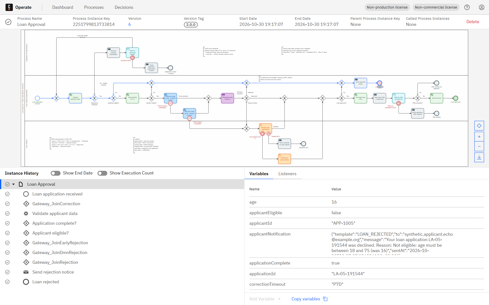

**04-operate-instance-L1-06-backup-bureau** – Operate – executed instance (token path highlighted) – scenario L1-06

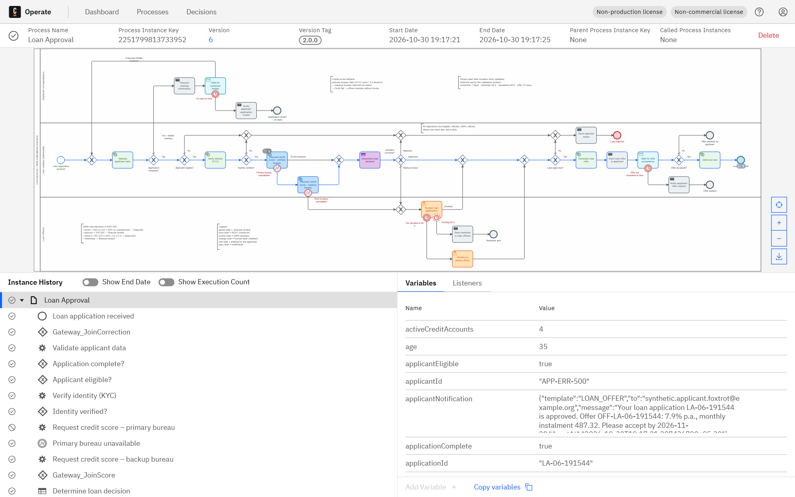

**04-operate-instance-L1-08-both-bureaus-down** – Operate – executed instance (token path highlighted) – scenario L1-08

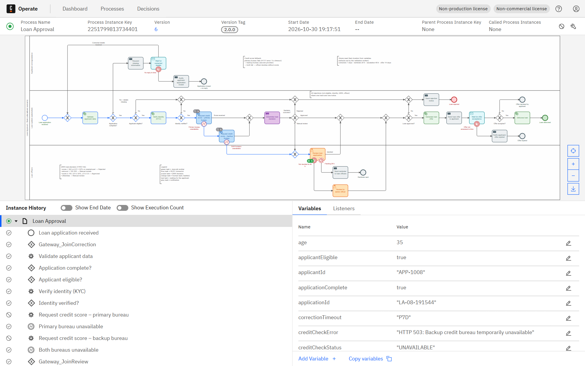

**04-operate-instance-L1-11-corrected-and-disbursed** – Operate – executed instance (token path highlighted) – scenario L1-11


**04-operate-instance-L1-11-waiting-for-correction** – Operate – executed instance (token path highlighted) – scenario L1-11

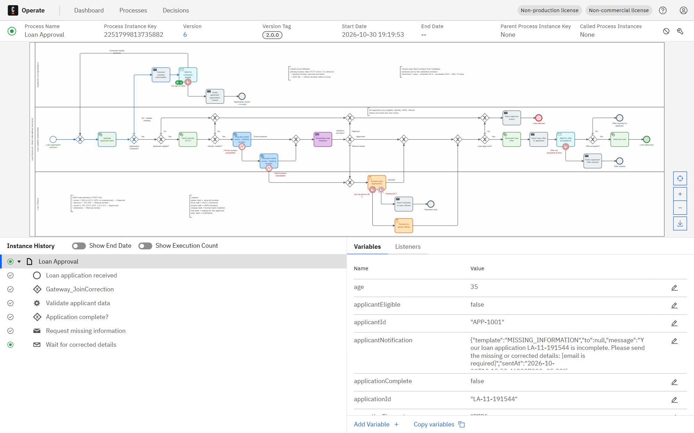

**04-operate-instance-L1-12-closed-no-reply** – Operate – executed instance (token path highlighted) – scenario L1-12

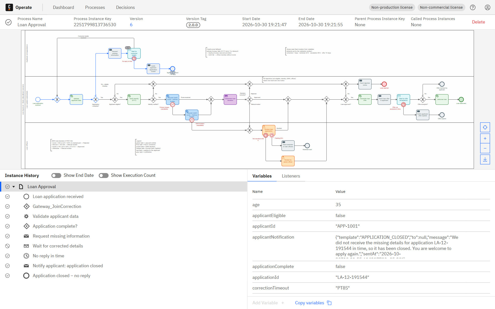

**04-operate-instance-L1-13-kyc-failed** – Operate – executed instance (token path highlighted) – scenario L1-13

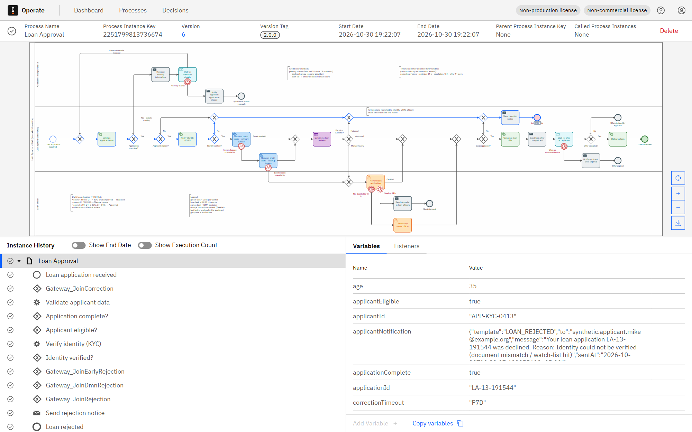

**04-operate-instance-L1-14-escalated-to-senior** – Operate – executed instance (token path highlighted) – scenario L1-14

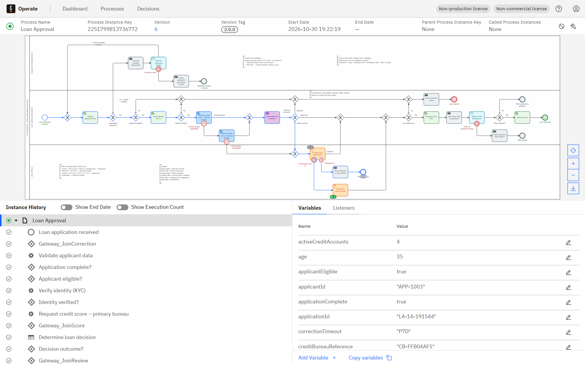

**04-operate-instance-L1-15-offer-expired** – Operate – executed instance (token path highlighted) – scenario L1-15

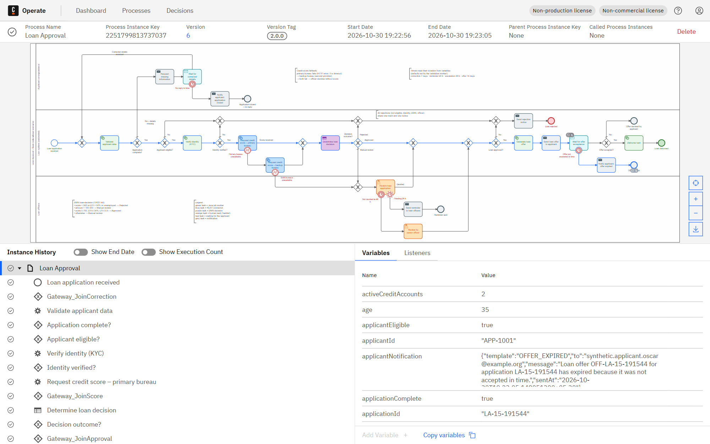

**05-tasklist-task-list** – Tasklist – open human tasks


**06-tasklist-task-form-completed** – Tasklist – task completed in the UI


**06-tasklist-task-form** – Tasklist – task form filled in by the reviewer (assigned to me)


**07-operate-incident-L1-09** – Operate – incident raised after the failure (instance marked red) – scenario L1-09

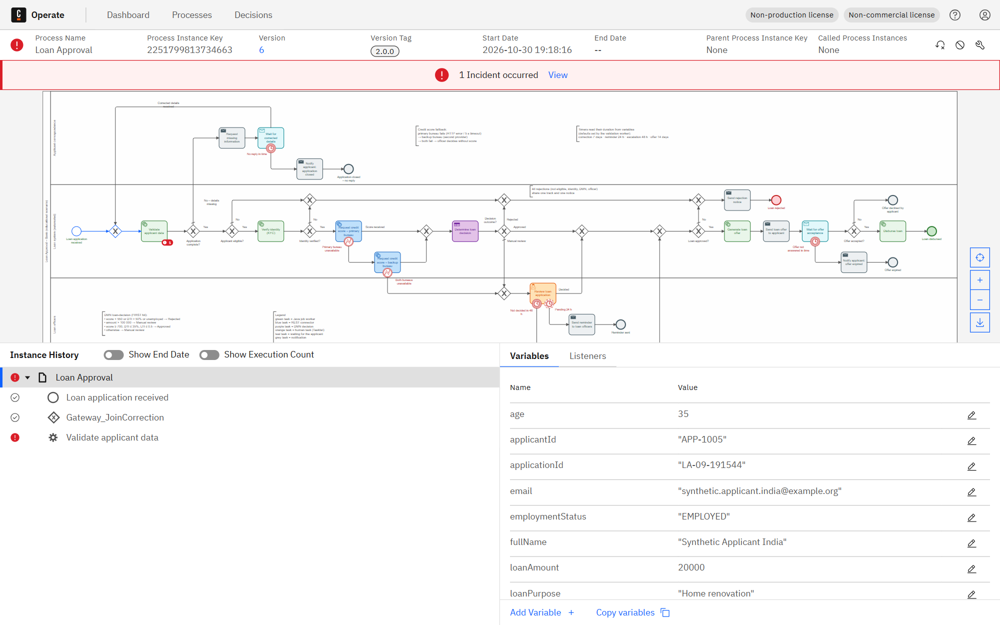

**08-operate-incident-detail-L1-09** – Operate – incidents view: type, failing element, error message – scenario L1-09


**08-operate-incident-detail-L1-10-malformed-variable** – Operate – incidents view: type, failing element, error message – scenario L1-10

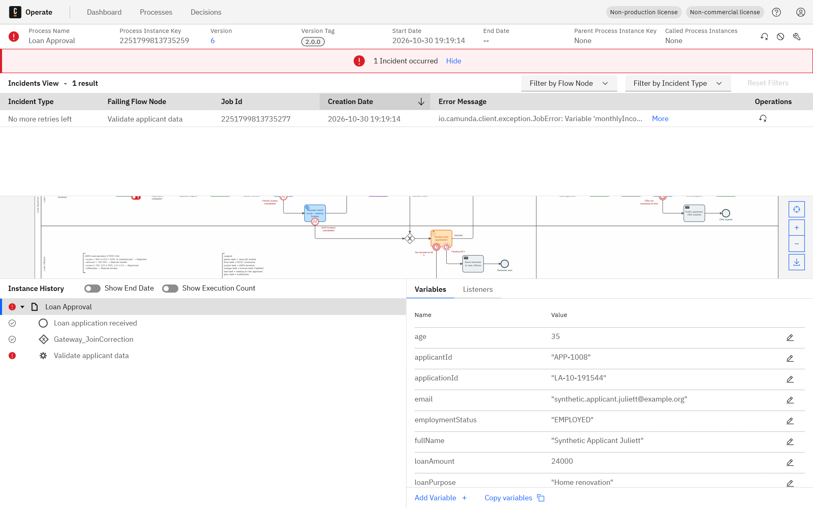

**08-operate-incident-message-L1-09** – Operate – full incident error message (diagnosis) – scenario L1-09


**08-operate-incident-message-L1-10** – Operate – full incident error message (diagnosis) – scenario L1-10

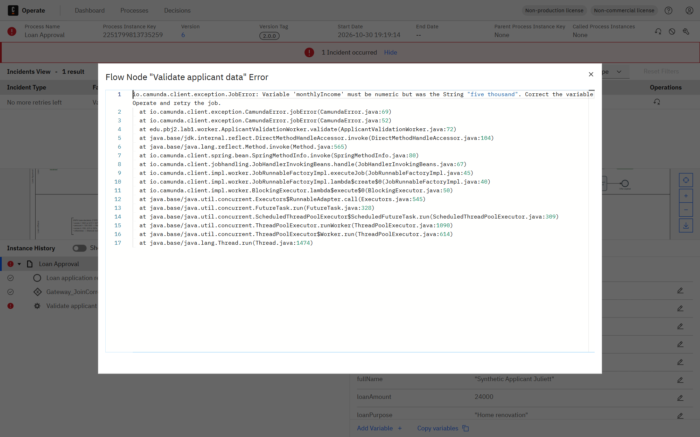

**09-operate-recovered-L1-09** – Operate – same instance after the cause was fixed and the job retried: completed – scenario L1-09


**09-operate-recovered-L1-10** – Operate – same instance after the cause was fixed and the job retried: completed – scenario L1-10


**10-operate-variables-L1-17** – Operate – process variables of a completed instance – scenario L1-17


<!-- SCREENSHOTS:END -->
