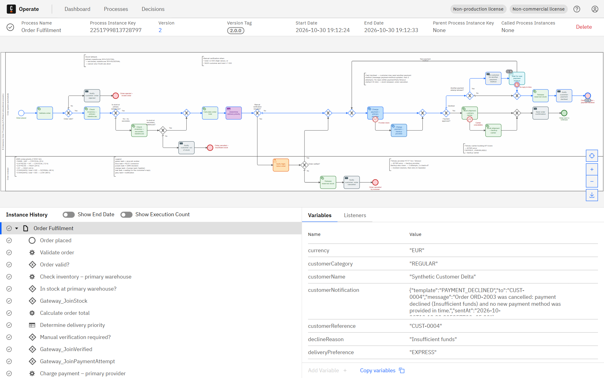
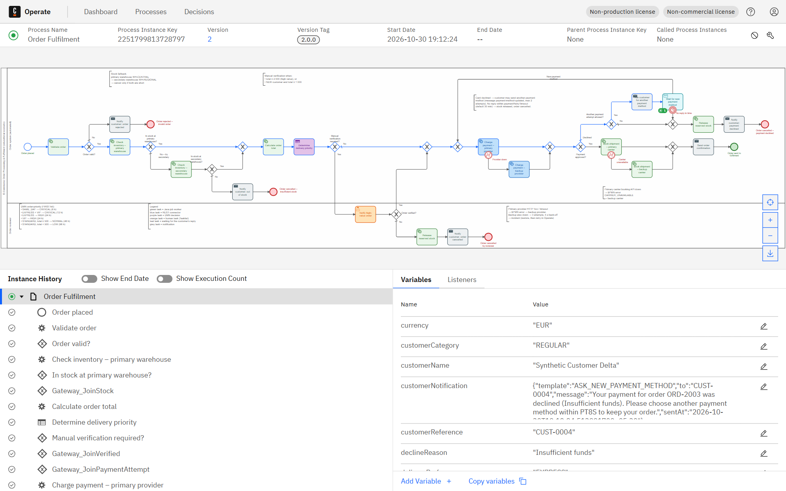
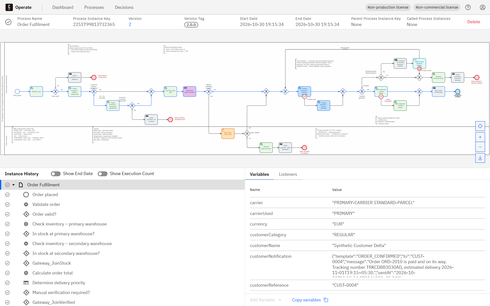
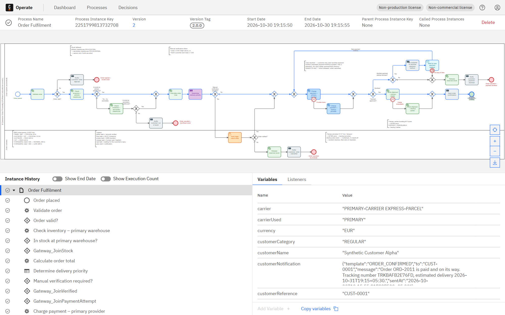
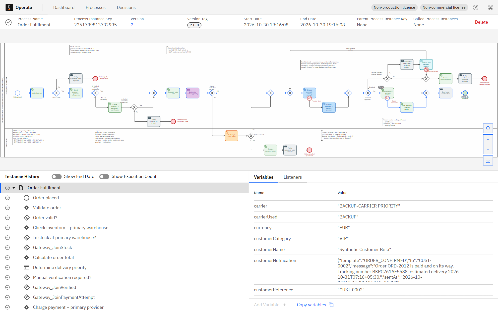
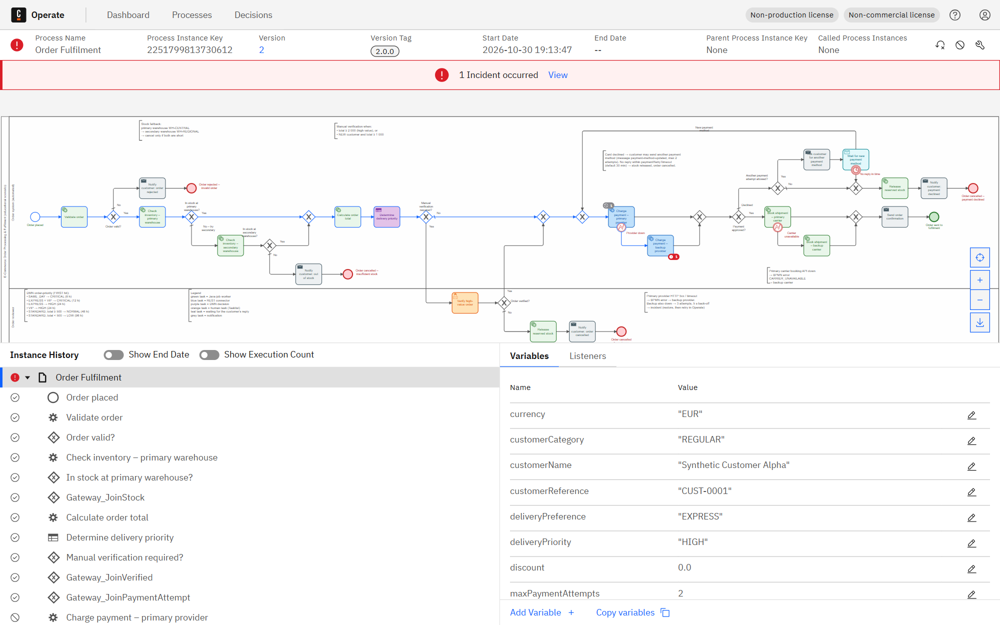
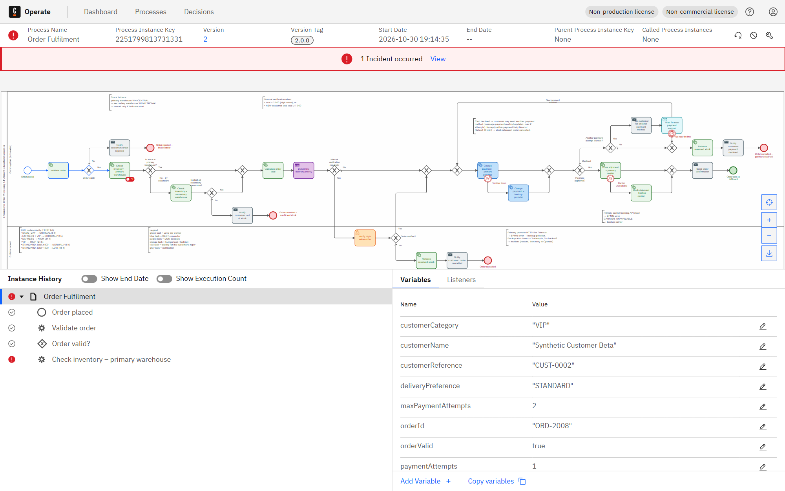
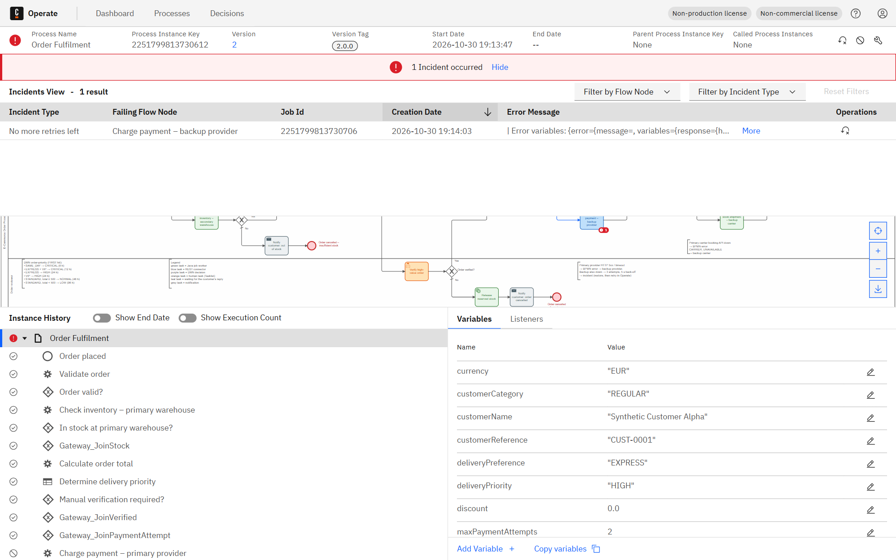
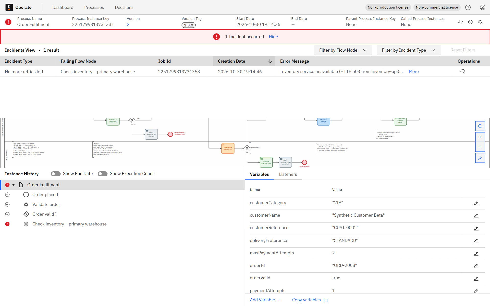
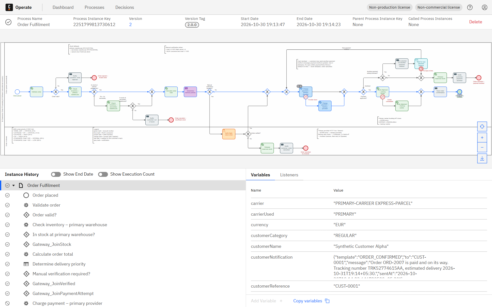

# Lab 2 – End-to-End E-Commerce Order Processing and Fulfilment (Camunda 8)

> **Synthetic data only.** Customers, products, stock and prices are fictitious and held in memory. Payments use
> **mock tokens** (`tok_test_*`) against two mock payment providers. No real payment credentials exist anywhere in this repository.

| Item | Value |
|---|---|
| BPMN process | `order-fulfilment` (version tag 2.0.0) – [`src/main/resources/models/order-fulfilment.bpmn`](src/main/resources/models/order-fulfilment.bpmn) |
| DMN decision | `order-priority` – [`src/main/resources/models/order-priority.dmn`](src/main/resources/models/order-priority.dmn) |
| Form (Tasklist) | `order-verification-form` |
| Worker application | Spring Boot 3.5.16, Camunda Spring Boot Starter 8.8.32, Java 21, port **8082** |
| Engine | Camunda 8 Run 8.8.32 (Zeebe, Operate, Tasklist, Connectors 8.8.15) on localhost |


## 1. Problem and scope

The workflow:
1. validates an order,
2. reserves stock in the **primary warehouse**, falling back to a **secondary warehouse**,
3. calculates the order total,
4. sets the delivery priority with a DMN table,
5. sends high-value or exceptional orders to a human reviewer,
6. charges the **primary payment provider** through a REST Connector, falling back to a **backup provider** when the primary one is down,
7. after a decline, gives the customer a limited chance to provide **another payment method**,
8. books the shipment with the **primary carrier**, falling back to a **backup carrier**.

If the order cannot be completed, it is cancelled with compensation: the reserved stock is released. Every run is visible in Operate.

Real e-commerce systems fail in predictable ways, so each one has a modelled answer:

| Real-world pitfall | Modelled solution | Shown by |
|---|---|---|
| Primary warehouse sold out | Check and reserve in the secondary warehouse; cancel only if both are short | L2-10, L2-02 |
| Primary payment provider down (HTTP 5xx / timeout) | Connector error expression → BPMN error `PAYMENT_PROVIDER_DOWN` → backup provider | L2-09 |
| **Both** payment providers down | Backup connector retries 3× (5 s back-off) → **incident** → operator restores the provider → retry | L2-07 |
| Card declined | Customer may send another payment method (message `payment-method-updated`, at most 2 attempts) | L2-11 |
| Customer never answers | Interrupting timer (`paymentRetryTimeout`, default 30 min) → stock released → order cancelled | L2-03 |
| Primary carrier booking API down | Worker throws BPMN error `CARRIER_UNAVAILABLE` → backup carrier | L2-12 |
| Inventory service down | Worker retries 3× (5 s back-off) → **incident** → service restored → retry | L2-08 |
| High-value / unusual order | Human verification in Tasklist before any money is taken | L2-04, L2-05 |

## 2. Architecture

```
┌──────────────────────── Camunda 8 Run (localhost) ────────────────────────┐
│ Zeebe engine ─ runs BPMN "order-fulfilment", evaluates DMN "order-priority"│
│ Connectors runtime (:8086) ─ executes the two "Charge payment" REST tasks  │
│ Tasklist (:8080/tasklist) ─ "Verify high-value order"                      │
│ Operate  (:8080/operate)  ─ monitoring, variables, incidents, retry        │
└───────────────▲──────────────────────────────────────────▲────────────────┘
                │ gRPC :26500 (job workers)                │ HTTP POST (connectors)
┌───────────────┴──────────────────────────────────────────┴────────────────┐
│ lab2-order-fulfilment (Spring Boot :8082)                                  │
│  • job workers: order.validate, order.check-inventory (PRIMARY/SECONDARY), │
│    order.calculate-total, order.request-payment-method,                    │
│    order.release-stock, order.book-shipment (PRIMARY/BACKUP),              │
│    order.notify-customer                                                   │
│  • domain: InventoryService (2 warehouses), CustomerRegistry, OrderPricing,│
│    OrderValidator, PaymentRetryPolicy                                      │
│  • mock payment providers POST /mock/payment-gateway/{primary|backup}/charges│
│  • fault injection        /admin/faults/{name}?enabled=true|false          │
│  • @Deployment of BPMN + DMN + form on start-up                            │
└────────────────────────────────────────────────────────────────────────────┘
        ▲  message from the customer (REST: POST /v2/messages/publication)
        │  payment-method-updated
```

| Component | Responsibility |
|---|---|
| `OrderValidationWorker` / `OrderValidator` / `PaymentRetryPolicy` | Mandatory fields. Customer lookup → `customerCategory`. Product lookup → `productName`, `unitPrice`. Quantity 1–100, delivery preference, mock-token format. Sets the retry defaults: `paymentAttempts = 1`, `maxPaymentAttempts = 2`, `paymentRetryTimeout = PT30M` unless the order brings its own |
| `InventoryWorker` / `InventoryService` | One worker for both warehouse tasks; the task header `warehouse` (PRIMARY / SECONDARY) selects WH-CENTRAL or WH-REGIONAL. Reserves stock (`reservationId`) and releases it back **to the warehouse it came from** as compensation. Fault `inventory-service-down` |
| `PricingWorker` / `OrderPricing` | Subtotal, VIP 10% discount, shipping, 20% VAT → `orderTotal` |
| DMN `order-priority` | `deliveryPriority` + `slaHours` |
| REST Connector "Charge payment – primary provider" | Mock primary provider → `paymentStatus`, `transactionId`, `declineReason`, `paymentProvider`; outage → BPMN error |
| REST Connector "Charge payment – backup provider" | Mock backup provider; outage → retries → incident |
| `PaymentRetryWorker` | "Ask customer for another payment method": notifies the customer and counts the attempt |
| `ShipmentWorker` | One worker for both carrier tasks (task header `carrier`). Commits the reservation; `shipmentId`, `trackingNumber`, `carrier`, `estimatedDelivery`. Fault `primary-carrier-down` → BPMN error |
| `NotificationWorker` | All other customer messages; the template comes from the BPMN task header `template` |
| `PaymentGatewayController` | The two mock providers, with deterministic mock tokens and the faults `primary-payment-down` / `backup-payment-down` |

## 3. BPMN model and execution flow

How the diagram is laid out (one pool, two lanes):
- **Order system (automated)**, with the **happy path in one straight row** through its middle:
  Order placed → Validate order → Check inventory – primary warehouse → Calculate order total → Determine delivery priority (DMN) → Charge payment – primary provider → Book shipment – primary carrier → Send order confirmation → **Order sent to fulfilment**.
- **Every fallback branches one row down and re-joins the happy path** through an explicit join gateway: secondary warehouse, backup payment provider, backup carrier.
- **Cancellations branch up or down to their own tail**: invalid order (up), out of stock (down), payment declined (up).
- **The "new payment method" retry** goes up as well. Its loop back to the payment step runs along the very top of the lane, so it crosses nothing.
- **Order reviewer** lane: verification and the reviewer-rejection tail.
- Gateways are questions with labelled answers; end events name the outcome; no flows cross.
- Colours: green = Java worker, blue = REST connector, purple = DMN, orange = human task, **teal = waiting for the customer's reply**, grey = notification, red = cancellation end, red boundary = error/timer. Annotations explain each fallback and rule, and a legend explains the colours.

### Gateway routing

| Gateway | Condition (FEEL) | Route |
|---|---|---|
| Order valid? | `orderValid = true` | Yes → primary warehouse · default No → notify → **Order rejected – invalid order** |
| In stock at primary warehouse? | `stockStatus = "AVAILABLE"` | Yes → join · default No → **secondary warehouse** |
| In stock at secondary warehouse? | `stockStatus = "AVAILABLE"` | Yes → join · default No → notify → **Order cancelled – insufficient stock** |
| Manual verification required? | `orderTotal >= 2000 or (customerCategory = "NEW" and orderTotal >= 1000)` | Yes → **Verify high-value order** (Tasklist) · default No → payment |
| Order verified? | `verificationDecision = "APPROVED"` | Yes → payment · default No → release stock → notify → **Order cancelled by reviewer** |
| Payment approved? | `paymentStatus = "APPROVED"` | Yes → primary carrier · default Declined → retry decision |
| Another payment attempt allowed? | `paymentAttempts < maxPaymentAttempts` | Yes → ask customer → wait for new payment method · default No → release stock → notify → **Order cancelled – payment declined** |

Boundary events:

| Boundary event | Attached to | Type | Effect |
|---|---|---|---|
| Provider down | Charge payment – primary provider | error `PAYMENT_PROVIDER_DOWN` (interrupting) | sets `paymentFallbackUsed = true`, `primaryPaymentError` → backup provider |
| No reply in time | Wait for new payment method | timer `=paymentRetryTimeout` (interrupting) | → release stock → notify → cancelled |
| Carrier unavailable | Book shipment – primary carrier | error `CARRIER_UNAVAILABLE` (interrupting) | → backup carrier |

Design notes:
- **Verification comes before payment**, so no money is taken from an order a reviewer may still reject.
- **Stock is reserved before payment and released as compensation** on a final decline, a customer timeout or a reviewer rejection. A reservation is always returned to the warehouse it was taken from.
- **A decline is not an error.** The provider answers HTTP 200 with `DECLINED`, which is a business outcome for a gateway. Only technical failures (5xx / timeout) trigger the provider fallback or an incident.
- **Fallback first, incident last.** A provider or carrier outage is routed to an alternative automatically. An incident is raised only when no alternative is left (both payment providers down) or none exists (inventory service down).
- **Timers read their duration from a variable** (`paymentRetryTimeout`, default `PT30M`), so the tests fire the real timer in 8 seconds while production keeps 30 minutes.
- DMN and user-task outputs (`priorityDecision`, `verificationDecision`, `verificationComment`) are mapped back to process scope explicitly; with output mappings, Zeebe would otherwise keep them local to the task.

## 4. DMN `order-priority` (hit policy FIRST, educational rules)

| # | Delivery preference | Customer category | Order total | → Priority | → SLA (h) | Rule ID | Description |
|---|---|---|---|---|---|---|---|
| 1 | `"SAME_DAY"` | – | – | `CRITICAL` | 8 | OP-1 | Same-day delivery is always the most urgent |
| 2 | `"EXPRESS"` | `"VIP"` | – | `CRITICAL` | 12 | OP-2 | Express delivery for VIP customers |
| 3 | `"EXPRESS"` | – | – | `HIGH` | 24 | OP-3 | Express delivery for everyone else |
| 4 | – | `"VIP"` | – | `HIGH` | 24 | OP-4 | VIP customers get priority even on standard delivery |
| 5 | `"STANDARD"` | – | `>= 500` | `NORMAL` | 48 | OP-5 | Standard delivery, high basket value |
| 6 | `"STANDARD"` | – | `< 500` | `LOW` | 96 | OP-6 | Standard delivery, low basket value |

Generated documentation: [`docs/dmn-order-priority.md`](docs/dmn-order-priority.md). Real sample evaluations against the deployed decision: [`docs/dmn-sample-evaluations.md`](docs/dmn-sample-evaluations.md).


## 5. REST Connectors (payment)

Both tasks use the REST Outbound Connector (`io.camunda.connectors.HttpJson.v2`, job type `io.camunda:http-json:1`) with no authentication (local mock). A real provider would use a connector secret such as `{{secrets.PAYMENT_API_KEY}}`, never a value in the model.

| Property | Charge payment – primary provider | Charge payment – backup provider |
|---|---|---|
| Method / URL | `POST http://localhost:8082/mock/payment-gateway/primary/charges` | `POST http://localhost:8082/mock/payment-gateway/backup/charges` |
| Body | `={orderId: orderId, amount: orderTotal, currency: currency, paymentToken: paymentToken, customerReference: customerReference}` | same |
| Timeouts | connect 5 s, read 5 s | connect 5 s, read 10 s |
| Result expression | `={paymentStatus: response.body.status, transactionId: response.body.transactionId, declineReason: response.body.declineReason, paymentProvider: response.body.provider}` | same |
| Error expression | `=if error != null and (string(error.code) = "408" or starts with(string(error.code), "5")) then bpmnError("PAYMENT_PROVIDER_DOWN", "Primary payment provider unavailable", {primaryPaymentError: "HTTP " + string(error.code) + ": " + (…response body error… or error.message)}) else null` | none, on purpose: the last line of defence becomes an incident |
| Retries | 1 (an outage goes to the backup immediately) | 3, task header `retryBackoff = PT5S` → incident `JOB_NO_RETRIES` |

Mock tokens: `tok_test_approve` → APPROVED · `tok_test_decline_funds` → DECLINED "Insufficient funds" · `tok_test_decline_fraud` → DECLINED "Suspected fraud" · any other → DECLINED "Unknown payment token".

Real request/response examples, captured from the running mock: [`primary-charge-approved.json`](api-examples/primary-charge-approved.json), [`primary-charge-declined.json`](api-examples/primary-charge-declined.json), [`primary-charge-503-provider-down.json`](api-examples/primary-charge-503-provider-down.json), [`backup-charge-approved.json`](api-examples/backup-charge-approved.json), [`backup-charge-503-provider-down.json`](api-examples/backup-charge-503-provider-down.json). The [`payment-gateway.http`](api-examples/payment-gateway.http) file also covers fault switching, starting an instance, the customer's new-payment-method message and a DMN evaluation.

## 6. Process-variable dictionary

| Variable | Type | Set by | Purpose |
|---|---|---|---|
| `orderId` | string | start | order business key; also the **message correlation key** |
| `customerReference` | string | start | synthetic customer (`CUST-000x`) |
| `productId` | string | start | catalogue product |
| `quantity` | integer | start | units ordered (1–100) |
| `deliveryPreference` | string | start | `STANDARD` / `EXPRESS` / `SAME_DAY` |
| `paymentToken` | string | start; replaced by the `payment-method-updated` message | mock token (never card data) |
| `paymentRetryTimeout` | string (ISO-8601 duration) | start (optional) / validation worker default `PT30M` | how long to wait for a new payment method |
| `maxPaymentAttempts` | integer | start (optional) / validation worker default 2 | upper bound of payment attempts |
| `paymentAttempts` | integer | validation worker (1), ask-for-new-method worker (+1) | drives "Another payment attempt allowed?" |
| `orderValid`, `validationErrors` | boolean, list | Validate order | drives "Order valid?" + reasons |
| `customerName`, `customerCategory` | string | Validate order | `NEW` / `REGULAR` / `VIP` (DMN input) |
| `productName`, `unitPrice` | string, number | Validate order | pricing + review form |
| `primaryWarehouseAvailable`, `secondaryWarehouseAvailable` | integer | inventory tasks | stock seen in each warehouse (audit) |
| `stockStatus` | string | inventory tasks | `AVAILABLE` / `INSUFFICIENT`; drives both stock gateways |
| `stockSource`, `warehouse` | string | inventory task that reserved | `PRIMARY` / `SECONDARY`, `WH-CENTRAL` / `WH-REGIONAL` |
| `reservationId`, `reservationStatus` | string | inventory / release / shipment workers | reservation handle; `RESERVED` → `RELEASED` / `COMMITTED` |
| `subtotal`, `discount`, `shippingFee`, `tax`, `orderTotal`, `currency` | number / string | Calculate order total | pricing; `orderTotal` feeds the DMN, verification rule and payment |
| `priorityDecision` | context | DMN task | `{deliveryPriority, slaHours, ruleId}` |
| `deliveryPriority`, `slaHours` | string, number | DMN output mapping | carrier service level + estimated delivery |
| `verificationDecision`, `verificationComment` | string | Tasklist user task | drives "Order verified?" |
| `paymentStatus`, `transactionId`, `declineReason` | string | payment connectors | drives "Payment approved?" |
| `paymentProvider` | string | payment connectors | `PRIMARY` / `BACKUP`: who charged the card |
| `paymentFallbackUsed`, `primaryPaymentError` | boolean, string | error boundary "Provider down" | why the backup provider was used |
| `carrierUsed`, `carrier`, `primaryCarrierError` | string | shipment workers / carrier BPMN error | `PRIMARY` / `BACKUP` and the carrier service booked |
| `shipmentId`, `trackingNumber`, `dispatchWarehouse`, `estimatedDelivery` | string | shipment worker | hand-off to fulfilment |
| `customerNotification` | context | notification / retry workers | last message sent to the customer |

## 7. Test cases and results (real runs)

<!-- TEST_RESULTS:BEGIN -->
| ID | Scenario | Category | Expected route | Actual outcome (end event) | Process instance key | Status |
|---|---|---|---|---|---|---|
| L2-01 | Stock available and payment approved | success | Validate → primary warehouse reserves → total → DMN LOW → primary provider APPROVED → primary carrier → fulfilment | `EndEvent_OrderFulfilled` | `2251799813728223` | **PASS** |
| L2-02 | Both warehouses short – order cannot proceed to fulfilment | rejection | Validate → primary warehouse short (2 < 5) → secondary warehouse short (1 < 5) → notify → cancelled | `EndEvent_OutOfStock` | `2251799813728544` | **PASS** |
| L2-03 | Payment declined, customer does not send a new payment method in time | rejection | … → primary provider DECLINED → retry allowed → ask customer → no reply within paymentRetryTimeout (8 s) → stock released → cancelled | `EndEvent_PaymentDeclined` | `2251799813728797` | **PASS** |
| L2-04 | High-value order routed to manual verification – reviewer approves in Tasklist | manual-review | Validate → reserve → total 2080.91 (≥ 2000) → DMN CRITICAL → reviewer APPROVES → payment APPROVED → fulfilment | `EndEvent_OrderFulfilled` | `2251799813729118` | **PASS** |
| L2-05 | NEW customer exception order – reviewer rejects | manual-review | Validate → reserve → NEW customer, total ≥ 1000 → reviewer REJECTS → stock released → cancelled | `EndEvent_CancelledByReviewer` | `2251799813730004` | **PASS** |
| L2-06 | Invalid product ID – order rejected by validation | validation | Validate → orderValid = false → notify → rejected | `EndEvent_OrderRejected` | `2251799813730422` | **PASS** |
| L2-07 | Both payment providers down → incident → backup provider restored → retry → fulfilled | failure-recovery | … → primary provider 503 → BPMN error → backup provider 503 ×3 (5 s back-off) → INCIDENT → backup restored → retry → APPROVED → fulfilment | `EndEvent_OrderFulfilled – after incident `JOB_NO_RETRIES` on `Task_ChargeBackup` was resolved` | `2251799813730612` | **PASS** |
| L2-08 | Inventory service outage → incident → service restored → retry → fulfilled | failure-recovery | Validate → inventory service 503 ×3 (5 s back-off) → INCIDENT → service restored → retry → reserved → fulfilment | `EndEvent_OrderFulfilled – after incident `JOB_NO_RETRIES` on `Task_CheckPrimaryWarehouse` was resolved` | `2251799813731331` | **PASS** |
| L2-09 | Primary payment provider down → backup provider charges → fulfilled | fallback | … → primary provider 503 → BPMN error PAYMENT_PROVIDER_DOWN → backup provider APPROVED → fulfilment | `EndEvent_OrderFulfilled` | `2251799813731946` | **PASS** |
| L2-10 | Primary warehouse sold out → secondary warehouse reserves → fulfilled | fallback | Validate → primary warehouse short (0) → secondary warehouse reserves → … → fulfilment | `EndEvent_OrderFulfilled` | `2251799813732365` | **PASS** |
| L2-11 | Card declined → customer sends a new payment method → paid → fulfilled | fallback | … → primary provider DECLINED → ask customer → message payment-method-updated (new token) → loop back → APPROVED → fulfilment | `EndEvent_OrderFulfilled` | `2251799813732708` | **PASS** |
| L2-12 | Primary carrier booking API down → backup carrier → fulfilled | fallback | … → payment APPROVED → primary carrier BPMN error CARRIER_UNAVAILABLE → backup carrier → fulfilment | `EndEvent_OrderFulfilled` | `2251799813732995` | **PASS** |

**12 of 12 scenarios passed** in the last full run. Per-scenario actions, incident messages and key variables: [`evidence/run-log.json`](evidence/run-log.json).
<!-- TEST_RESULTS:END -->

Scenario definitions (inputs, steps, expected end event): [`test-data/`](test-data/).

What the fallback runs recorded (real variable values):
- **L2-09:** `paymentProvider = BACKUP`, `paymentFallbackUsed = true`, `primaryPaymentError = "HTTP 503: Primary payment provider temporarily unavailable"`.
- **L2-10:** `primaryWarehouseAvailable = 0`, `secondaryWarehouseAvailable = 40`, `stockSource = SECONDARY`, `warehouse = WH-REGIONAL`.
- **L2-11:** the first charge was declined ("Suspected fraud"). The customer's message carried a new token, the order was paid on attempt 2 (`paymentAttempts = 2`) and fulfilled.
- **L2-03:** the 8-second `paymentRetryTimeout` timer **fired** (boundary "No reply in time" completed). The stock was `RELEASED` and the order cancelled.
- **L2-12:** `carrierUsed = BACKUP` after the primary carrier's BPMN error.

### Incident investigation and recovery

| Scenario | Injected cause | What Operate shows | Correction | Retry |
|---|---|---|---|---|
| L2-07 | faults `primary-payment-down` **and** `backup-payment-down` → both providers answer HTTP 503 | Primary step terminated by the error boundary. Incident `JOB_NO_RETRIES` on **Charge payment – backup provider** after 3 attempts 5 s apart; the message contains the 503 response "Backup payment provider temporarily unavailable" | both faults switched off (providers "restored") | job retries set to 1 + incident resolved (Operate *Retry*, or `PATCH /v2/jobs/{key}` + `POST /v2/incidents/{key}/resolution`) → charged by the backup provider → fulfilled |
| L2-08 | fault `inventory-service-down` | Incident `JOB_NO_RETRIES` on **Check inventory – primary warehouse** with "Inventory service unavailable (HTTP 503 from inventory-api). Fix: restore the service (…) and retry." | fault switched off | retry → stock reserved → fulfilled |

The inventory worker fails the job explicitly with `JobClient.newFailCommand(...).retries(n).retryBackoff(5 s).errorMessage(...)`, so Operate shows a clean message instead of a stack trace.

## 8. How to run

1. Start Camunda 8 Run 8.8. Operate and Tasklist are at http://localhost:8080 with the local demo user.
2. `mvn -pl lab2-order-fulfilment spring-boot:run`: deploys the models and starts the workers and both mock providers.
3. Unit tests: `mvn -pl lab2-order-fulfilment test` (9 tests: pricing, validation, two-warehouse reservation/release, retry policy).
4. Start an order: `POST http://localhost:8080/v2/process-instances` with `{"processDefinitionId": "order-fulfilment", "variables": {…}}`. Use the `variables` block of any file in [`test-data/`](test-data/); see [`api-examples/payment-gateway.http`](api-examples/payment-gateway.http).
5. Reproduce a pitfall by switching a fault on before starting (`POST http://localhost:8082/admin/faults/primary-payment-down?enabled=true`, etc.).
6. Answer a waiting order as the customer: `POST http://localhost:8080/v2/messages/publication` with `{"name": "payment-method-updated", "correlationKey": "<orderId>", "variables": {"paymentToken": "tok_test_approve"}}`.
7. Watch instances in Operate; complete "Verify high-value order" in Tasklist.

Alternative: open the model files in Camunda Modeler and deploy them to `localhost:26500` (authentication: None).

## 9. Assumptions

- Synthetic in-memory customers, products, two warehouses, stock and prices, all reset on restart.
- EUR, 20% VAT and a VIP 10% discount (educational values).
- The verification thresholds (2 000, or 1 000 for `NEW` customers) live in the gateway, because the brief asks the DMN for **priority** only.
- A customer gets one extra payment attempt by default (`maxPaymentAttempts = 2`) and 30 minutes to provide it.
- Notifications are logged, not e-mailed.
- Candidate group `order-reviewers`. Authorizations are disabled in Camunda 8 Run's local setup, so the demo user can complete the task.

## 10. Limitations

- The mock providers have no idempotency key. With real providers, a charge retried after a timeout could be duplicated; use `orderId` as the idempotency key.
- There is no split shipment: if neither warehouse can cover the full quantity on its own, the order is cancelled, even when both together could.
- The backup carrier has no fault switch of its own; a backup-carrier outage would be retried by Zeebe and then become an incident.
- There is no timer or escalation on the verification task (Lab 1 shows that pattern).
- In Camunda 8.8 a new incident is briefly `PENDING` before it becomes `ACTIVE`.

## 11. Screenshots (captured from the running implementation)

<!-- SCREENSHOTS:BEGIN -->
**01-bpmn-design** – BPMN process design (rendered from the deployed .bpmn with bpmn-js, the Modeler's renderer)


**02-dmn-decision-table** – DMN decision table


**03-operate-decision-instances** – Operate – evaluated decision instances


**03-operate-deployed-process-instances** – Deployment evidence – Operate: deployed process definition with instance counts per element


**04-operate-instance-L2-01** – Operate – executed instance (token path highlighted) – scenario L2-01


**04-operate-instance-L2-02** – Operate – executed instance (token path highlighted) – scenario L2-02


**04-operate-instance-L2-03-timer-fired** – Operate – executed instance (token path highlighted) – scenario L2-03



**04-operate-instance-L2-03-waiting-for-customer** – Operate – executed instance (token path highlighted) – scenario L2-03



**04-operate-instance-L2-04** – Operate – executed instance (token path highlighted) – scenario L2-04


**04-operate-instance-L2-05** – Operate – executed instance (token path highlighted) – scenario L2-05


**04-operate-instance-L2-09-backup-provider** – Operate – executed instance (token path highlighted) – scenario L2-09


**04-operate-instance-L2-10-secondary-warehouse** – Operate – executed instance (token path highlighted) – scenario L2-10



**04-operate-instance-L2-11-new-payment-method** – Operate – executed instance (token path highlighted) – scenario L2-11



**04-operate-instance-L2-12-backup-carrier** – Operate – executed instance (token path highlighted) – scenario L2-12



**05-tasklist-task-list** – Tasklist – open human tasks


**06-tasklist-task-form-completed** – Tasklist – task completed in the UI


**06-tasklist-task-form** – Tasklist – task form filled in by the reviewer (assigned to me)


**07-operate-incident-L2-07** – Operate – incident raised after the failure (instance marked red) – scenario L2-07



**07-operate-incident-L2-08** – Operate – incident raised after the failure (instance marked red) – scenario L2-08



**08-operate-incident-detail-L2-07** – Operate – incidents view: type, failing element, error message – scenario L2-07



**08-operate-incident-detail-L2-08** – Operate – incidents view: type, failing element, error message – scenario L2-08



**09-operate-recovered-L2-07** – Operate – same instance after the cause was fixed and the job retried: completed – scenario L2-07



**09-operate-recovered-L2-08** – Operate – same instance after the cause was fixed and the job retried: completed – scenario L2-08


**10-operate-variables-L2-01** – Operate – process variables of a completed instance – scenario L2-01


<!-- SCREENSHOTS:END -->
