# Lab 2 – End-to-End E-Commerce Order Processing and Fulfilment (Camunda 8)

> **Synthetic data only.** Customers, products, stock and prices are fictitious and held in memory. Payments use
> **mock tokens** (`tok_test_*`) against a mock gateway. No real payment credentials exist anywhere in this repository.

| Item | Value |
|---|---|
| BPMN process | `order-fulfilment` – [`src/main/resources/models/order-fulfilment.bpmn`](src/main/resources/models/order-fulfilment.bpmn) |
| DMN decision | `order-priority` – [`src/main/resources/models/order-priority.dmn`](src/main/resources/models/order-priority.dmn) |
| Form (Tasklist) | `order-verification-form` |
| Worker application | Spring Boot 3.5.16, Camunda Spring Boot Starter 8.8.32, Java 21, port **8082** |
| Engine | Camunda 8 Run 8.8.32 (Zeebe, Operate, Tasklist, Connectors 8.8.15) on localhost |
| Diagram source | generated by `scripts/bpmn/lab2_order_fulfilment.py` / `scripts/bpmn/lab2_order_priority_dmn.py` |

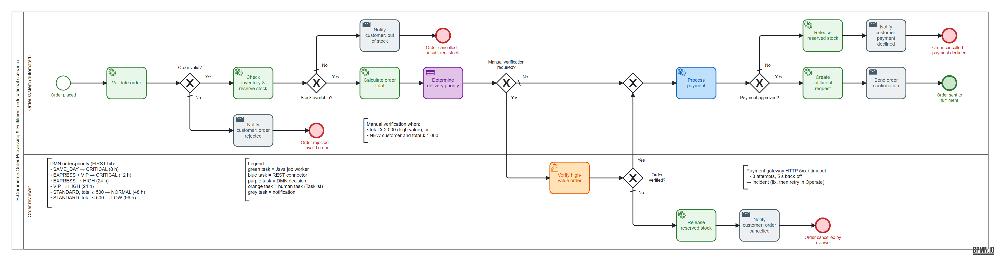

## 1. Problem and scope

The workflow:
1. validates an order,
2. checks and reserves stock,
3. calculates the order total,
4. sets the delivery priority with a DMN table,
5. sends high-value or exceptional orders to a human reviewer,
6. charges a mock payment gateway through the REST Connector,
7. then either hands the order to fulfilment or cancels it with compensation (the reserved stock is released).

Every run is visible in Operate. Two failures can be caused on purpose, diagnosed and recovered: a payment gateway outage and an inventory service outage.

## 2. Architecture

```
┌──────────────────────── Camunda 8 Run (localhost) ────────────────────────┐
│ Zeebe engine ─ runs BPMN "order-fulfilment", evaluates DMN "order-priority"│
│ Connectors runtime (:8086) ─ executes REST task "Process payment"          │
│ Tasklist (:8080/tasklist) ─ "Verify high-value order"                      │
│ Operate  (:8080/operate)  ─ monitoring, variables, incidents, retry        │
└───────────────▲──────────────────────────────────────────▲────────────────┘
                │ gRPC :26500 (job workers)                │ HTTP POST (connector)
┌───────────────┴──────────────────────────────────────────┴────────────────┐
│ lab2-order-fulfilment (Spring Boot :8082)                                  │
│  • job workers: order.validate, order.check-inventory,                     │
│    order.calculate-total, order.release-stock, order.create-shipment,      │
│    order.notify-customer                                                   │
│  • domain: InventoryService, CustomerRegistry, OrderPricing, OrderValidator │
│  • mock payment gateway  POST /mock/payment-gateway/charges                │
│  • fault injection       /admin/faults/{inventory-service-down|            │
│                                         payment-gateway-down}              │
│  • @Deployment of BPMN + DMN + form on start-up                            │
└────────────────────────────────────────────────────────────────────────────┘
```

| Component | Responsibility |
|---|---|
| `OrderValidationWorker` / `OrderValidator` | Mandatory fields. Customer lookup → `customerCategory`. Product lookup → `productName`, `unitPrice`. Quantity 1–100, delivery preference, mock-token format |
| `InventoryWorker` / `InventoryService` | Checks and reserves stock (`reservationId`); releases the reservation as compensation; can be broken with the fault `inventory-service-down` |
| `PricingWorker` / `OrderPricing` | Subtotal, VIP 10% discount, shipping, 20% VAT → `orderTotal` |
| DMN `order-priority` | `deliveryPriority` + `slaHours` |
| REST Connector "Process payment" | Calls the mock gateway → `paymentStatus`, `transactionId`, `declineReason` |
| `ShipmentWorker` | Commits the reservation; `shipmentId`, `trackingNumber`, `carrier`, `estimatedDelivery` |
| `NotificationWorker` | All customer messages; the template comes from the BPMN task header `template` |
| `PaymentGatewayController` | Deterministic mock tokens + fault `payment-gateway-down` |

## 3. BPMN model and execution flow

- One pool with the lanes **Order system (automated)** and **Order reviewer**.
- The **happy path is one straight line**. Cancellations branch **up** (out of stock, payment declined) or **down** (invalid order, reviewer rejection), and no flows cross.
- Gateways are worded as questions with labelled flows, and end events name the outcome.
- Colours: green = Java worker, blue = REST connector, purple = DMN, orange = human task, grey = notification, red = cancellation end. Annotations summarise the DMN rules, the verification rule and the payment failure behaviour; a legend explains the colours.

**Happy path:** Order placed → Validate order → Check inventory & reserve stock → Calculate order total → Determine delivery priority (DMN) → *(no verification needed)* → Process payment (REST) → Create fulfilment request → Send order confirmation → **Order sent to fulfilment**.

### Gateway routing

| Gateway | Condition (FEEL) | Route |
|---|---|---|
| Order valid? | `orderValid = true` | Yes → inventory · default No → notify → **Order rejected – invalid order** |
| Stock available? | `stockStatus = "AVAILABLE"` | Yes → pricing · default No → notify → **Order cancelled – insufficient stock** |
| Manual verification required? | `orderTotal >= 2000 or (customerCategory = "NEW" and orderTotal >= 1000)` | Yes → **Verify high-value order** (Tasklist) · default No → payment |
| Order verified? | `verificationDecision = "APPROVED"` | Yes → payment · default No → release stock → notify → **Order cancelled by reviewer** |
| Payment approved? | `paymentStatus = "APPROVED"` | Yes → fulfilment · default No → release stock → notify → **Order cancelled – payment declined** |

Design notes:
- **Verification comes before payment**, so no money is taken from an order a reviewer may still reject.
- **Stock is reserved before payment and released as compensation** on a decline or a rejection. The runs show `RELEASED` for L2-03 and L2-05, and `COMMITTED` after fulfilment.
- DMN and user-task outputs (`priorityDecision`, `verificationDecision`, `verificationComment`) are mapped back to process scope explicitly. Without that, Zeebe keeps them local to the task when output mappings exist.

## 4. DMN `order-priority` (hit policy FIRST, educational rules)

| # | Delivery preference | Customer category | Order total | → Priority | → SLA (h) | Rule ID | Description |
|---|---|---|---|---|---|---|---|
| 1 | `"SAME_DAY"` | – | – | `CRITICAL` | 8 | OP-1 | Same-day delivery is always the most urgent |
| 2 | `"EXPRESS"` | `"VIP"` | – | `CRITICAL` | 12 | OP-2 | Express delivery for VIP customers |
| 3 | `"EXPRESS"` | – | – | `HIGH` | 24 | OP-3 | Express delivery for everyone else |
| 4 | – | `"VIP"` | – | `HIGH` | 24 | OP-4 | VIP customers get priority even on standard delivery |
| 5 | `"STANDARD"` | – | `>= 500` | `NORMAL` | 48 | OP-5 | Standard delivery, high basket value |
| 6 | `"STANDARD"` | – | `< 500` | `LOW` | 96 | OP-6 | Standard delivery, low basket value |

Generated documentation: [`docs/dmn-order-priority.md`](docs/dmn-order-priority.md). Real sample evaluations against the deployed decision: [`docs/dmn-sample-evaluations.md`](docs/dmn-sample-evaluations.md).

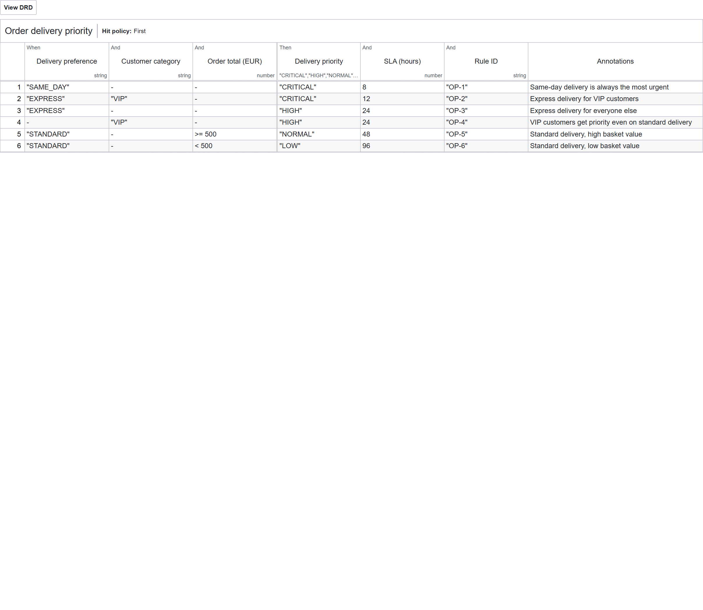

## 5. REST Connector "Process payment"

| Property | Value |
|---|---|
| Template / job type | REST Outbound Connector `io.camunda.connectors.HttpJson.v2` / `io.camunda:http-json:1` |
| Authentication | none (local mock). A real gateway would use a connector secret such as `{{secrets.PAYMENT_API_KEY}}`, never a value in the model |
| Method / URL | `POST http://localhost:8082/mock/payment-gateway/charges` |
| Body | `={orderId: orderId, amount: orderTotal, currency: currency, paymentToken: paymentToken, customerReference: customerReference}` |
| Timeouts | connect 5 s, read 10 s |
| Result expression | `={paymentStatus: response.body.status, transactionId: response.body.transactionId, declineReason: response.body.declineReason}` |
| Error expression | none, on purpose: a **decline** is a business result (HTTP 200 + `DECLINED`), while 5xx and timeouts are technical failures that are retried and then become an **incident** |
| Retries | 3, task header `retryBackoff = PT5S` → then incident `JOB_NO_RETRIES` |

Mock tokens: `tok_test_approve` → APPROVED · `tok_test_decline_funds` → DECLINED "Insufficient funds" · `tok_test_decline_fraud` → DECLINED "Suspected fraud" · `tok_test_gateway_error` → HTTP 503 · any other → DECLINED "Unknown payment token".

Real request/response examples: [`api-examples/payment-approved.json`](api-examples/payment-approved.json), [`payment-declined.json`](api-examples/payment-declined.json), [`payment-gateway-503.json`](api-examples/payment-gateway-503.json), [`payment-gateway.http`](api-examples/payment-gateway.http).

## 6. Process-variable dictionary

| Variable | Type | Set by | Purpose |
|---|---|---|---|
| `orderId` | string | start | order business key |
| `customerReference` | string | start | synthetic customer (`CUST-000x`) |
| `productId` | string | start | catalogue product |
| `quantity` | integer | start | units ordered (1–100) |
| `deliveryPreference` | string | start | `STANDARD` / `EXPRESS` / `SAME_DAY` |
| `paymentToken` | string | start | mock token (never card data) |
| `orderValid`, `validationErrors` | boolean, list | Validate order | drives "Order valid?" + reasons |
| `customerName`, `customerCategory` | string | Validate order | `NEW` / `REGULAR` / `VIP` (DMN input) |
| `productName`, `unitPrice` | string, number | Validate order | pricing + review form |
| `stockStatus`, `availableQuantity` | string, integer | Check inventory | `AVAILABLE` / `INSUFFICIENT`; drives "Stock available?" |
| `reservationId`, `warehouse` | string | Check inventory | reservation handle, dispatch warehouse |
| `reservationStatus` | string | inventory / release / shipment workers | `RESERVED` → `RELEASED` / `COMMITTED` |
| `subtotal`, `discount`, `shippingFee`, `tax`, `orderTotal`, `currency` | number / string | Calculate order total | pricing; `orderTotal` feeds the DMN, the verification rule and the payment |
| `priorityDecision` | context | DMN task | `{deliveryPriority, slaHours, ruleId}` |
| `deliveryPriority`, `slaHours` | string, number | DMN output mapping | carrier choice + estimated delivery |
| `verificationDecision`, `verificationComment` | string | Tasklist user task | drives "Order verified?" |
| `paymentStatus`, `transactionId`, `declineReason` | string | REST connector | drives "Payment approved?" |
| `shipmentId`, `trackingNumber`, `carrier`, `dispatchWarehouse`, `estimatedDelivery` | string | Create fulfilment request | hand-off to fulfilment |
| `customerNotification` | context | Notification worker | last message sent |

## 7. Test cases and results (real runs)

<!-- TEST_RESULTS:BEGIN -->
| ID | Scenario | Category | Expected route | Actual outcome (end event) | Process instance key | Status |
|---|---|---|---|---|---|---|
| L2-01 | Stock available and payment approved | success | Validate → reserve stock → total 215.76 → DMN LOW → no verification → payment APPROVED → fulfilment | `EndEvent_OrderFulfilled` | `2251799813713817` | **PASS** |
| L2-02 | Stock insufficient – order cannot proceed to fulfilment | rejection | Validate → stock check INSUFFICIENT (5 requested, 2 in stock) → notify customer → cancelled | `EndEvent_OutOfStock` | `2251799813713977` | **PASS** |
| L2-03 | Payment declined by the mock gateway | rejection | Validate → reserve → total 553.79 → DMN HIGH → payment DECLINED (insufficient funds) → release stock → notify → cancelled | `EndEvent_PaymentDeclined` | `2251799813714038` | **PASS** |
| L2-04 | High-value order routed to manual verification – reviewer approves | manual-review | Validate → reserve → total 2080.91 (≥ 2000) → DMN CRITICAL → reviewer APPROVES → payment APPROVED → fulfilment | `EndEvent_OrderFulfilled` | `2251799813714167` | **PASS** |
| L2-05 | NEW customer exception order – reviewer rejects | manual-review | Validate → reserve → total 1077.60 (NEW ≥ 1000) → DMN NORMAL → reviewer REJECTS → release stock → notify → cancelled | `EndEvent_CancelledByReviewer` | `2251799813714379` | **PASS** |
| L2-06 | Invalid product ID – order rejected by validation | validation | Validate → orderValid=false (unknown product) → notify customer → rejected | `EndEvent_OrderRejected` | `2251799813714504` | **PASS** |
| L2-07 | Payment gateway outage → incident → gateway restored → retry → fulfilled | failure-recovery | … → Process payment fails (HTTP 503) 3× → incident → fault off → retry job → APPROVED → fulfilment | `EndEvent_OrderFulfilled – after incident `JOB_NO_RETRIES` on `Task_ProcessPayment` was resolved` | `2251799813714551` | **PASS** |
| L2-08 | Inventory service outage → incident → service restored → retry → fulfilled | failure-recovery | Validate → Check inventory fails 3× (5 s back-off) → incident → fault off → retry job → reserve → … → fulfilment | `EndEvent_OrderFulfilled – after incident `JOB_NO_RETRIES` on `Task_CheckInventory` was resolved` | `2251799813714788` | **PASS** |

**8 of 8 scenarios passed** on the last full run (`python scripts/run_scenarios.py lab2-order-fulfilment --screenshots`). Per-scenario actions, incident messages and key variables: [`evidence/run-log.json`](evidence/run-log.json).
<!-- TEST_RESULTS:END -->

### Incident investigation and recovery

| Scenario | Injected cause | What Operate shows | Correction | Retry |
|---|---|---|---|---|
| L2-07 | fault `payment-gateway-down` → the gateway answers HTTP 503 | Incident `JOB_NO_RETRIES` on **Process payment** after 3 attempts 5 s apart; the message contains the 503 response | fault switched off (gateway "restored") | job retries set to 1 + incident resolved (Operate *Retry*, or `PATCH /v2/jobs/{key}` + `POST /v2/incidents/{key}/resolution`) → paid → fulfilled |
| L2-08 | fault `inventory-service-down` | Incident `JOB_NO_RETRIES` on **Check inventory & reserve stock** with "Inventory service unavailable (HTTP 503 from inventory-api). Fix: restore the service (…) and retry." | fault switched off | retry → stock reserved → fulfilled |

The inventory worker fails the job explicitly with `JobClient.newFailCommand(...).retries(n).retryBackoff(5 s).errorMessage(...)`, so Operate shows a clean message instead of a stack trace.

## 8. How to run

1. Start Camunda 8 Run 8.8 (see the root README). Operate and Tasklist are at http://localhost:8080 with the local demo user.
2. `mvn -pl lab2-order-fulfilment spring-boot:run`: deploys the models and starts the workers and the mock gateway.
3. Unit tests: `mvn -pl lab2-order-fulfilment test`.
4. Scenarios: `python scripts/run_scenarios.py lab2-order-fulfilment` (add `--screenshots` to capture evidence).
5. Try the decision directly: `python scripts/c8.py evaluate order-priority '{"deliveryPreference":"EXPRESS","customerCategory":"VIP","orderTotal":300}'`.

Alternative: open the three model files in Camunda Modeler and deploy them to `localhost:26500` (authentication: None).

## 9. Assumptions

- Synthetic in-memory customers, products, stock and prices, reset on every restart.
- EUR, 20% VAT and a VIP 10% discount (educational values).
- The verification thresholds (2 000, or 1 000 for `NEW` customers) live in the gateway, because the brief asks the DMN for **priority** only.
- Notifications are logged, not e-mailed.
- Candidate group `order-reviewers`. Authorizations are disabled in Camunda 8 Run's local setup, so the demo user can complete the task.

## 10. Limitations

- The mock gateway has no idempotency key; with a real gateway a retried charge could double-charge (use `orderId` as the idempotency key).
- There is no distributed transaction between payment and shipment; compensation covers declines and reviewer rejections only.
- There is no timer or escalation on the verification task (Lab 1 shows that pattern).
- In Camunda 8.8 a new incident is briefly `PENDING` before it becomes `ACTIVE`; the test tooling waits for both.

## 11. Screenshots (captured from the running implementation)

<!-- SCREENSHOTS:BEGIN -->
**01-bpmn-design** – BPMN process design (rendered from the deployed .bpmn with bpmn-js, the Modeler's renderer)


**02-dmn-decision-table** – DMN decision table


**03-operate-decision-instances** – Operate – evaluated decision instances

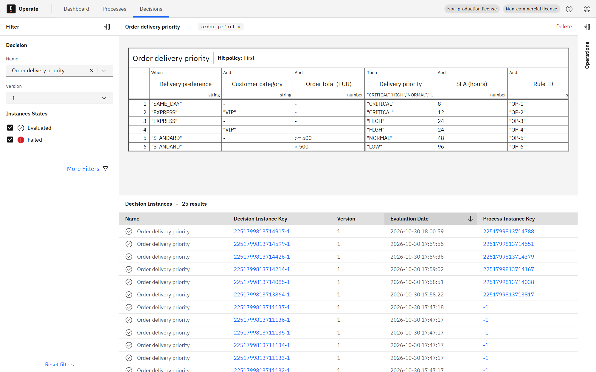

**03-operate-deployed-process-instances** – Deployment evidence – Operate: deployed process definition with instance counts per element

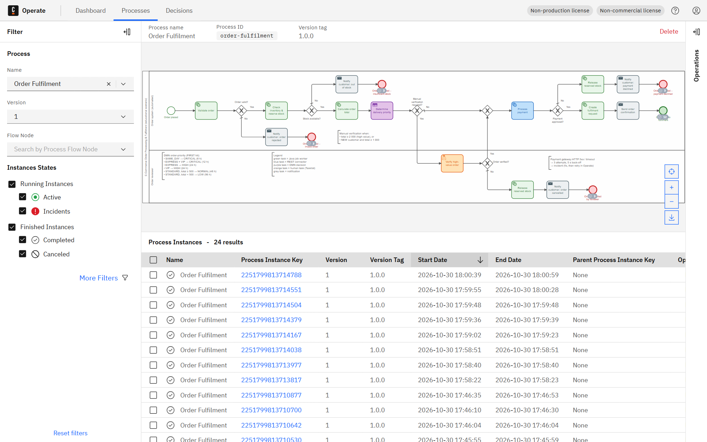

**04-operate-instance-L2-01** – Operate – executed instance (token path highlighted) – scenario L2-01

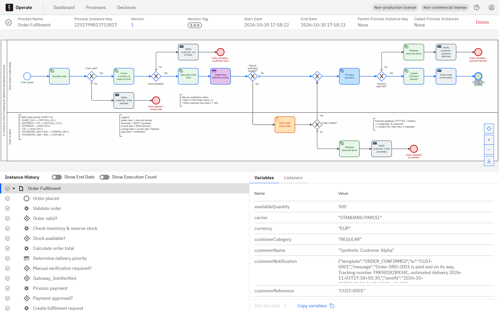

**04-operate-instance-L2-02** – Operate – executed instance (token path highlighted) – scenario L2-02

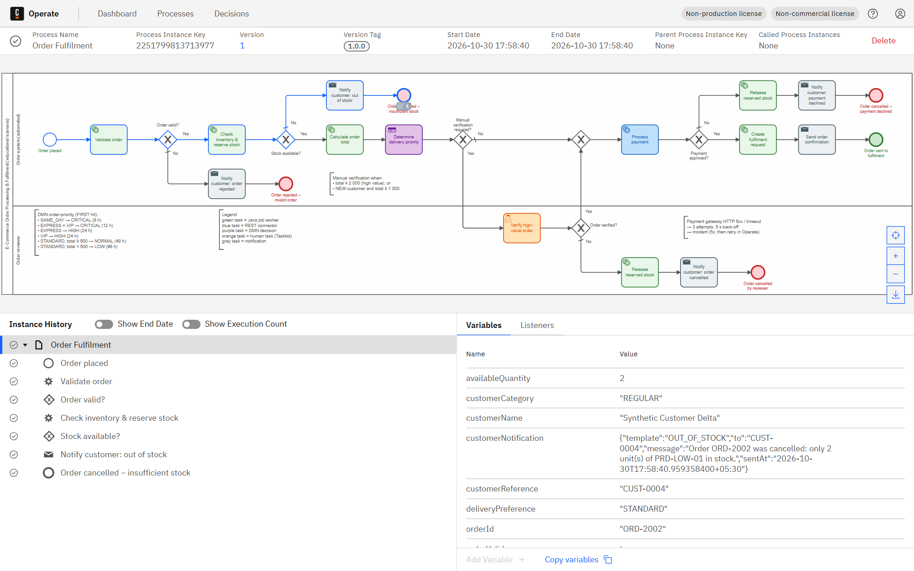

**04-operate-instance-L2-03** – Operate – executed instance (token path highlighted) – scenario L2-03

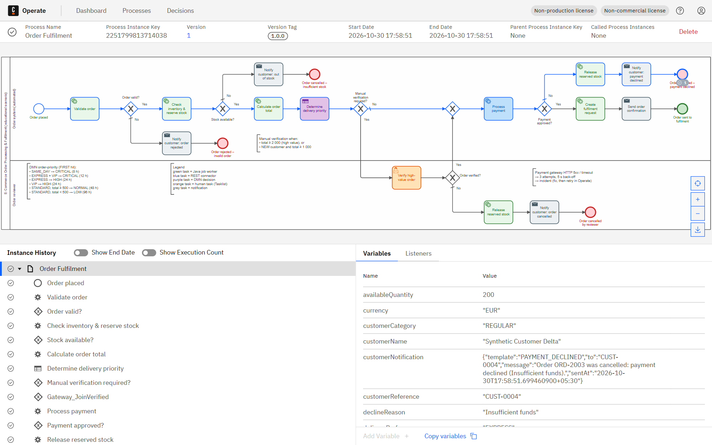

**04-operate-instance-L2-04** – Operate – executed instance (token path highlighted) – scenario L2-04

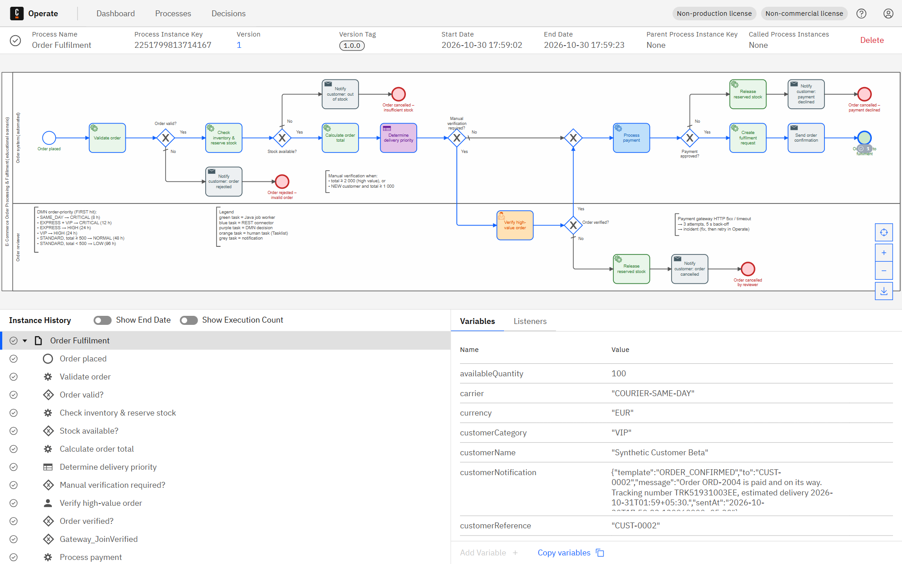

**04-operate-instance-L2-05** – Operate – executed instance (token path highlighted) – scenario L2-05

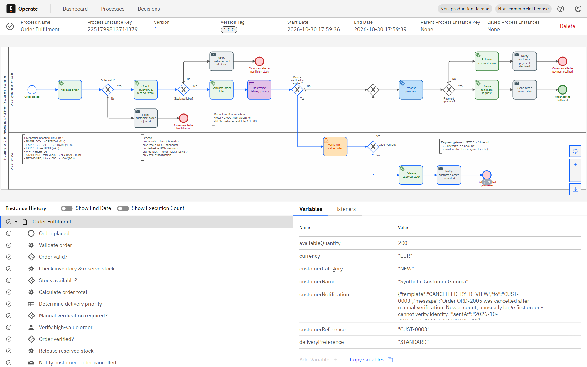

**05-tasklist-task-list** – Tasklist – open human tasks

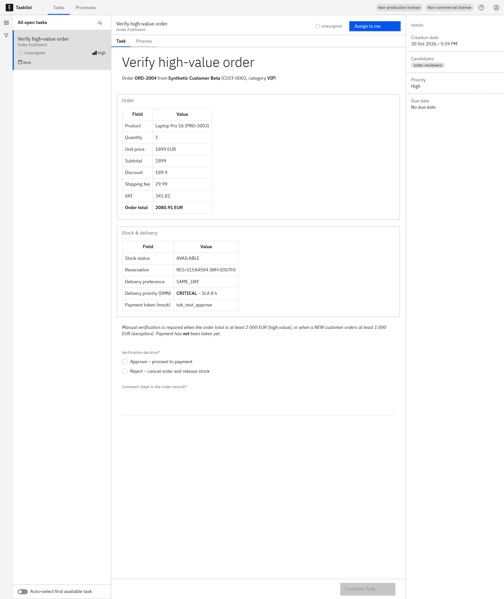

**06-tasklist-task-form-completed** – Tasklist – task completed in the UI

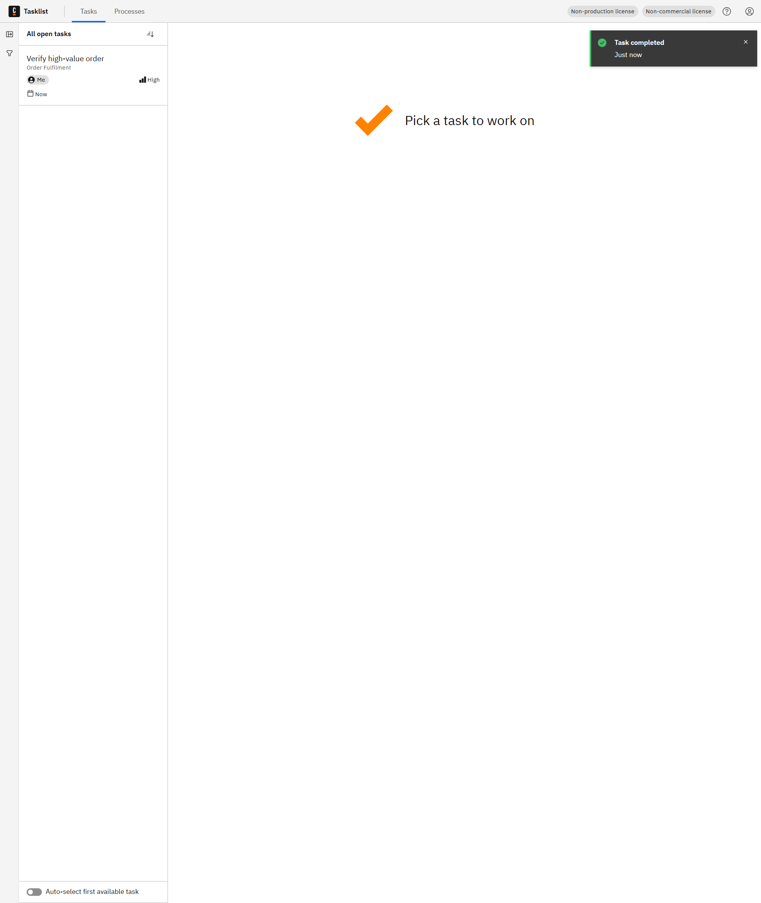

**06-tasklist-task-form** – Tasklist – task form filled in by the reviewer (assigned to me)

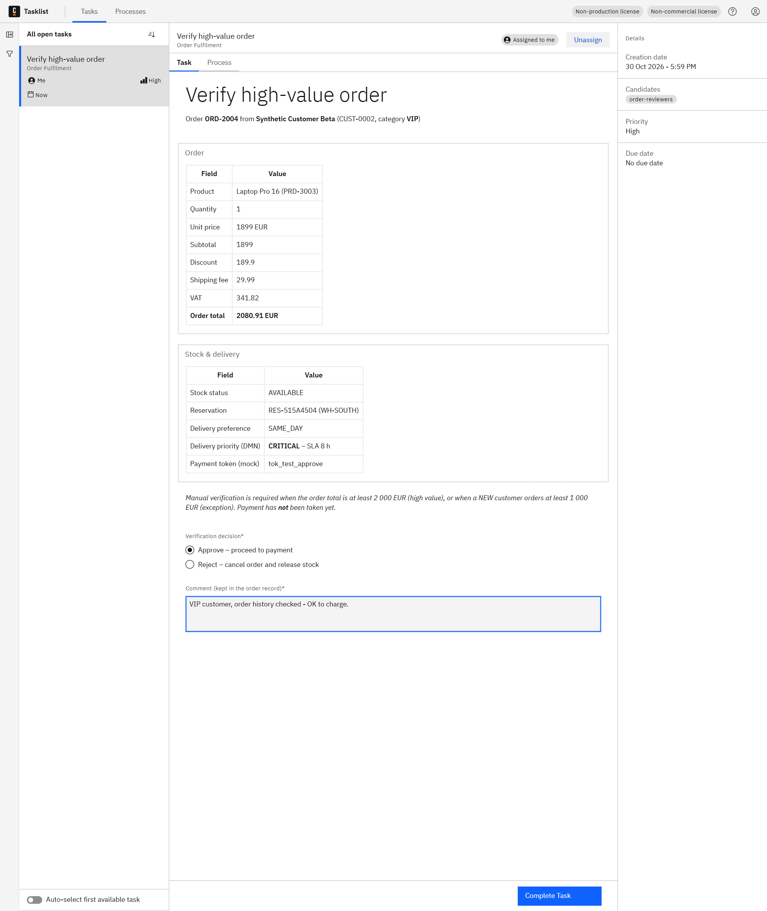

**07-operate-incident-inventory** – Operate – incident raised after the failure (instance marked red)

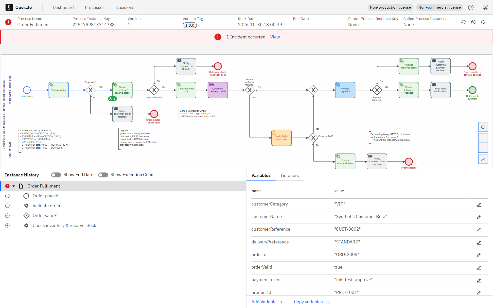

**07-operate-incident** – Operate – incident raised after the failure (instance marked red)

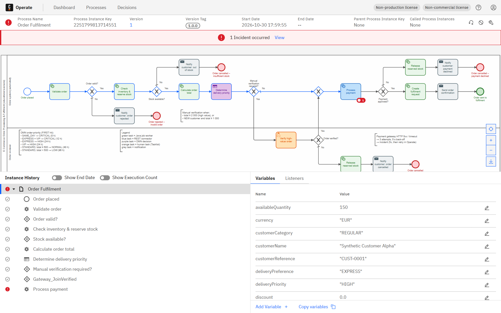

**08-operate-incident-detail** – Operate – incidents view: type, failing element, error message

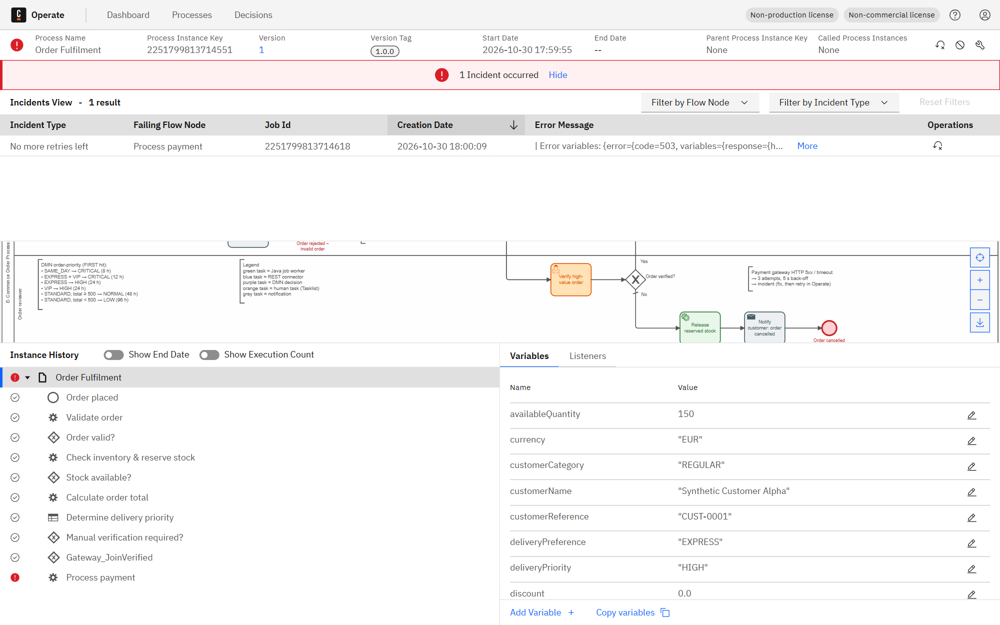

**09-operate-recovered-inventory** – Operate – same instance after the cause was fixed and the job retried: completed


**09-operate-recovered** – Operate – same instance after the cause was fixed and the job retried: completed


**10-operate-variables** – Operate – process variables of a completed instance


<!-- SCREENSHOTS:END -->
