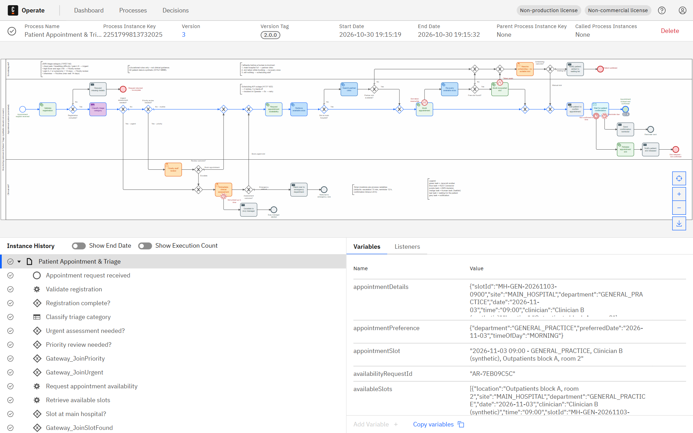
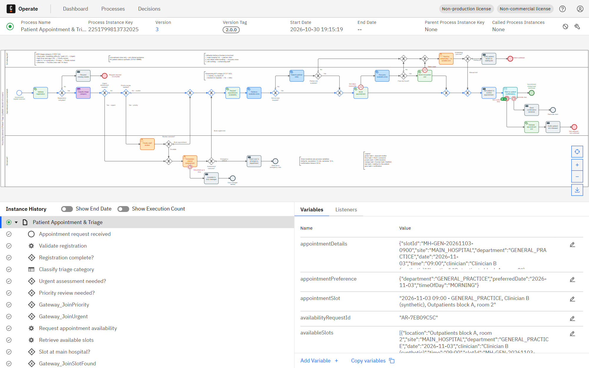
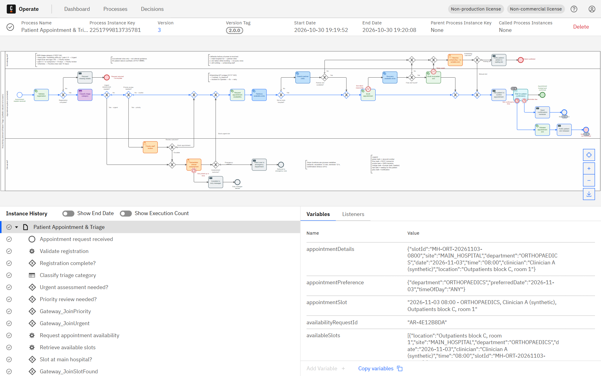
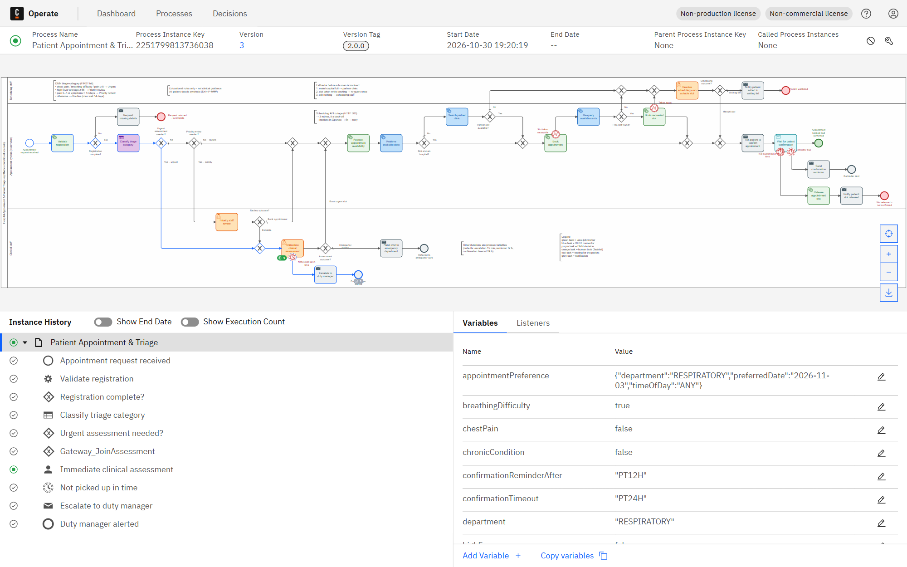
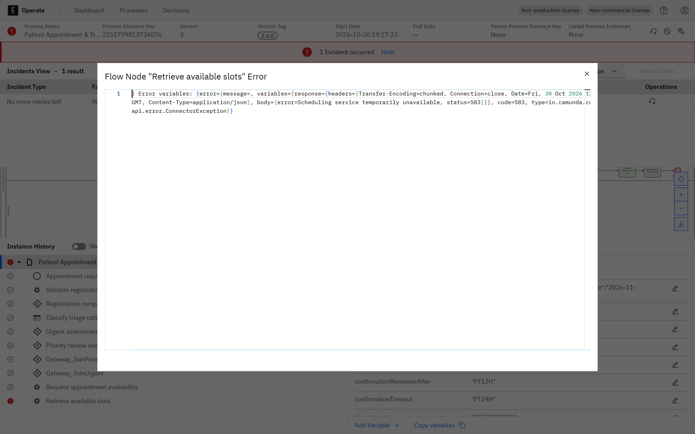

# Lab 3 – Hospital Appointment and Patient Triage Management (Camunda 8)

> **Synthetic educational scenario.** All triage rules are predefined teaching rules, **not clinical guidance**.
> All patient data is fictitious (`SYN-P-####`) and the hospital scheduling system is a mock API.

| Item | Value |
|---|---|
| BPMN process | `patient-appointment-triage` (version tag 2.0.0) – [`src/main/resources/models/patient-appointment-triage.bpmn`](src/main/resources/models/patient-appointment-triage.bpmn) |
| DMN decision | `triage-category` – [`src/main/resources/models/triage-category.dmn`](src/main/resources/models/triage-category.dmn) |
| Forms (Tasklist) | `urgent-assessment-form`, `priority-review-form`, `scheduling-resolution-form` |
| Message | `appointment-confirmed`, correlation key `patientReference` |
| Worker application | Spring Boot 3.5, Camunda Spring Boot Starter 8.8.32, Java 21, port **8083** |
| Engine | Camunda 8 Run 8.8.32 (Zeebe, Operate, Tasklist, Connectors 8.8.15) on localhost |


## 1. Architecture

```
┌──────────────────────── Camunda 8 Run (localhost) ────────────────────────┐
│ Zeebe engine ─ runs BPMN "patient-appointment-triage", evaluates DMN,      │
│                timers and the "appointment-confirmed" message              │
│ Connectors runtime (:8086) ─ 3 REST tasks: main-hospital slots,            │
│                partner-clinic slots, re-query after a booking conflict     │
│ Tasklist (:8080/tasklist) ─ the three human tasks                          │
│ Operate  (:8080/operate)  ─ monitoring, variables, incidents, retry        │
└───────────────▲──────────────────────────────────────────▲────────────────┘
                │ gRPC :26500 (job workers)                │ HTTP GET (connectors)
┌───────────────┴──────────────────────────────────────────┴────────────────┐
│ lab3-hospital-triage (Spring Boot :8083)                                   │
│  • job workers: triage.validate-registration, triage.request-availability, │
│    triage.book-appointment, triage.release-slot,                           │
│    triage.notify-patient, triage.notify-staff                              │
│  • mock scheduling API  /mock/scheduling/... (main hospital + partner      │
│    clinic calendars)                                                       │
│  • fault injection      /admin/faults/{scheduling-api-down|                │
│                                         booking-conflict-once}             │
│  • @Deployment of BPMN + DMN + forms on start-up                           │
└────────────────────────────────────────────────────────────────────────────┘
```

## 2. Execution flow

Lanes:
- **Scheduling staff** (top): the last resort when the automatic fallbacks fail.
- **Appointment system (automated)** (middle): the happy path is one straight line. Fallbacks branch **up** towards the staff lane, and the confirmation timers branch **down**.
- **Clinical staff** (bottom): priority review, urgent assessment and the escalation timer.

1. **Appointment request received** (start event).
2. **Validate registration** (Java worker). It also sets the timer defaults. Then *Registration complete?*
   - No → **Request missing details** → end **Request returned – incomplete**.
3. **Classify triage category** (DMN) → `urgencyCategory`, `triageReason`, `maxWaitDays`.
4. *Urgent assessment needed?*
   - Yes → **Immediate clinical assessment** (user task, group `urgent-care-team`).
     - A non-interrupting timer `=urgentEscalationAfter` (default 15 min) triggers **Escalate to duty manager** → end **Duty manager alerted**.
     - *Assessment outcome?* Emergency referral (default) → **Hand over to emergency department** → end **Referred to emergency care**. Book urgent slot → scheduling with `maxWaitDays = 0`.
5. *Priority review needed?*
   - Yes → **Priority staff review** (group `clinical-staff`), then *Review outcome?*
     - Book (default) → scheduling.
     - Escalate → urgent assessment.
   - No → routine → scheduling.
6. **Request appointment availability** (worker) → **Retrieve available slots** (REST, `site=MAIN_HOSPITAL`) → *Slot at main hospital?*
   - Yes → **Book appointment**.
   - No → **Search partner clinic** (REST, `site=PARTNER_CLINIC`) → *Partner slot available?*
     - Yes → **Book appointment** (at the partner clinic).
     - No → scheduling staff.
7. **Book appointment** (worker). If every retrieved slot was taken by someone else in the meantime (HTTP 409), the worker throws BPMN error `SLOT_TAKEN`. The error boundary **Slot taken meanwhile** leads to **Re-query available slots** (REST, same site) → *Free slot found?*
   - Yes → **Book re-queried slot**. If it is taken again, the boundary **Taken again** goes to scheduling staff.
   - No → scheduling staff.
8. **Resolve scheduling – no suitable slot** (group `scheduling-staff`), then *Scheduling outcome?*
   - Manual slot → confirmation.
   - Waiting list (default) → **Notify patient: added to waiting list** → end **Patient waitlisted**.
9. **Ask patient to confirm appointment** (send task) → **Wait for patient confirmation**. This receive task waits for message `appointment-confirmed`, correlated by `patientReference`.
   - Message received → end **Appointment booked and confirmed**.
   - Non-interrupting timer `=confirmationReminderAfter` (default 12 h) → **Send confirmation reminder** → end **Reminder sent**, while the wait continues.
   - Interrupting timer `=confirmationTimeout` (default 24 h) → **Release appointment slot** (worker cancels the booking) → **Notify patient: slot released** → end **Slot released – not confirmed**.

### Real-world pitfalls and how the process handles them

| Pitfall | Handling in the model | Human involved? | Shown by |
|---|---|---|---|
| Preferred hospital has no capacity | Second REST connector searches the **partner clinic** with the same availability request | only if the partner clinic is full too | L3-09 (partner slot), L3-04 / L3-08 (both full) |
| Slot taken by another patient between search and booking | Worker throws BPMN error `SLOT_TAKEN` → **one automatic re-query** → book again | only if it fails twice | L3-10 |
| Patient never confirms the booking | Reminder (non-interrupting timer), then timeout (interrupting timer) **releases the slot** for other patients | no | L3-11 |
| Urgent case not picked up by the urgent-care team | Non-interrupting escalation timer alerts the **duty manager**; the task stays open | duty manager is notified | L3-12 |
| Scheduling system down (HTTP 503) | Connector retries 3× with 5 s back-off, then an **incident** for an operator (fix and retry in Operate) | operator | L3-06 |
| Incomplete registration | Returned to the patient with the list of missing fields | no | L3-05 |

Why the slot-taken fallback is a forward path and not a loop back to "Retrieve available slots": a loop would have to cross the partner-clinic branch or the main line on its way to the scheduling staff. One automatic re-query, then staff, gives the same "maximum two attempts" behaviour with a diagram that has no crossing flows.

### Gateway routing

| Gateway | Outgoing flow | Condition (FEEL) |
|---|---|---|
| Registration complete? | Yes / No (default) | `registrationValid = true` |
| Urgent assessment needed? | Yes / No (default) | `urgencyCategory = "URGENT_ASSESSMENT"` |
| Priority review needed? | Yes / No – routine (default) | `urgencyCategory = "PRIORITY_REVIEW"` |
| Review outcome? | Escalate / Book (default) | `reviewOutcome = "ESCALATE_URGENT"` |
| Assessment outcome? | Book urgent slot / Emergency referral (default – the safest choice) | `assessmentOutcome = "BOOK_URGENT_SLOT"` |
| Slot at main hospital? | Yes / No (default) | `slotCount > 0` |
| Partner slot available? | Yes / No (default) | `slotCount > 0` |
| Free slot found? (after re-query) | Yes / No (default) | `slotCount > 0` |
| Scheduling outcome? | Manual slot / Waiting list (default) | `schedulingOutcome = "MANUAL_SLOT"` |

Unnamed diamonds are join gateways that merge paths before the next step (e.g. "slot found at main hospital or partner clinic", "booked automatically, after a re-query, or manually").

## 3. DMN `triage-category` (hit policy FIRST, educational rules only)

Full table: [`docs/dmn-triage-category.md`](docs/dmn-triage-category.md). Real sample evaluations: [`docs/dmn-sample-evaluations.md`](docs/dmn-sample-evaluations.md).

| Rule | Condition | Category | maxWaitDays |
|---|---|---|---|
| TR-1 | chest pain | URGENT_ASSESSMENT | 0 |
| TR-2 | breathing difficulty | URGENT_ASSESSMENT | 0 |
| TR-3 | pain level ≥ 8 | URGENT_ASSESSMENT | 0 |
| TR-4 | high fever and age ≥ 65 | PRIORITY_REVIEW | 2 |
| TR-5 | pain level 5–7 | PRIORITY_REVIEW | 3 |
| TR-6 | symptoms for more than 14 days | PRIORITY_REVIEW | 5 |
| TR-7 | otherwise | ROUTINE | 14 |

The business rule task stores the result in `triageResult` and maps `urgencyCategory`, `triageReason` and `maxWaitDays` to flat process variables for routing.


## 4. Job workers (Spring Boot)

| Job type | Class | What it does | Failure handling |
|---|---|---|---|
| `triage.validate-registration` | `RegistrationValidationWorker` / `RegistrationValidator` | Required fields and ranges, `SYN-P-####` format, department and time-of-day lists, ISO date. Unreported flags default to false; flattens the preference; sets timer defaults (`urgentEscalationAfter` PT15M, `confirmationReminderAfter` PT12H, `confirmationTimeout` PT24H) and validates supplied ones as ISO-8601 durations | Wrongly typed variable → retries 0 → incident; fix the variable in Operate and retry |
| `triage.request-availability` | `AvailabilityRequestWorker` / `SearchWindow` | Search window = today … today + `maxWaitDays`, starting at the preferred date if it is inside the window; registers the request with the scheduling API | API unreachable → retries − 1, 5 s back-off |
| `triage.book-appointment` | `BookingWorker` | Books the earliest retrieved slot (main hospital or partner clinic); tries the next one on HTTP 409 | All slots taken → **BPMN error `SLOT_TAKEN`** (business fallback); technical error → retries − 1, 5 s back-off |
| `triage.release-slot` | `ReleaseSlotWorker` | Cancels an unconfirmed booking so the slot is free again | retries − 1, 5 s back-off |
| `triage.notify-patient` / `triage.notify-staff` | `NotificationWorker` | Templates `CONFIRMATION_REQUEST`, `CONFIRMATION_REMINDER`, `SLOT_RELEASED`, `MISSING_DETAILS`, `WAITLISTED`, `ED_HANDOVER`, `DUTY_MANAGER_ESCALATION` (logged, not sent) | – |

Unit tests (`mvn -pl lab3-hospital-triage test`, 13 passing):
- `RegistrationValidatorTest` (6): incl. timer defaults/overrides and an invalid duration.
- `SearchWindowTest` (4).
- `SlotCalendarTest` (3): neurology only at the partner clinic, no dermatology anywhere, booking and releasing a slot.

## 5. REST Connectors

All three use the REST Outbound Connector template `io.camunda.connectors.HttpJson.v2` (job type `io.camunda:http-json:1`), no authentication (local mock, no secrets), connect timeout 5 s, read timeout 10 s, 3 retries with task header `retryBackoff = PT5S`, and **no error expression**: a scheduling outage must become an incident for an operator.

| Task | Request | Result expression |
|---|---|---|
| Retrieve available slots | `GET ="http://localhost:8083/mock/scheduling/availability-requests/" + availabilityRequestId + "/slots"`, query `={site: "MAIN_HOSPITAL"}` | `={availableSlots: response.body.slots, slotCount: count(response.body.slots), searchSite: "MAIN_HOSPITAL"}` |
| Search partner clinic | same URL, query `={site: "PARTNER_CLINIC"}` | `={availableSlots: …, slotCount: …, searchSite: "PARTNER_CLINIC"}` |
| Re-query available slots | same URL, query `={site: searchSite}` (the site where the conflict happened) | `={availableSlots: …, slotCount: …, searchSite: searchSite, requeried: true}` |

Real request/response examples: [`api-examples/`](api-examples/) (`scheduling-api.http` lists every call).

## 6. Mock scheduling API (port 8083)

| Endpoint | Called by | Behaviour |
|---|---|---|
| `POST /mock/scheduling/availability-requests` | worker `triage.request-availability` | registers a search → `AR-xxxxxxxx` |
| `GET /mock/scheduling/availability-requests/{id}/slots?site=MAIN_HOSPITAL\|PARTNER_CLINIC` | the three REST connectors | up to 5 earliest free slots of that site in the window |
| `POST /mock/scheduling/bookings` | worker `triage.book-appointment` | books a slot → `BK-xxxxxxxx`, `CONFIRMED`; HTTP 409 if already taken |
| `POST /mock/scheduling/bookings/{bookingReference}/cancellation` | worker `triage.release-slot` | releases the slot → `RELEASED` |
| `POST /admin/faults/scheduling-api-down?enabled=true\|false` | operator / test runner | slot queries answer HTTP 503 (incident demo) |
| `POST /admin/faults/booking-conflict-once?enabled=true` | test runner | "another patient" takes each slot we try to book (HTTP 409) until the next slot query; the switch then turns itself off |

Calendars (today + 21 days, 8 slots a day: 08:00–11:00 morning, 13:00–16:00 afternoon):

| Site | Departments with slots |
|---|---|
| MAIN_HOSPITAL | General practice, Cardiology, Orthopaedics, Respiratory |
| PARTNER_CLINIC | General practice, Orthopaedics, **Neurology** (only offered here → partner fallback) |
| both | **Dermatology has no slots** → exercises the scheduling-staff path |

## 7. Process-variable dictionary

| Variable | Type | Set by | Purpose |
|---|---|---|---|
| `patientReference` | string | start | synthetic patient ID (`SYN-P-####`); **message correlation key** |
| `patientAge` | number | start | DMN rule TR-4 |
| `appointmentPreference` | object {department, preferredDate, timeOfDay} | start | the patient's preference |
| `symptomsSummary` | string | start | shown to staff in the forms |
| `painLevel` | number 0–10 | start | rules TR-3 / TR-5 |
| `chestPain`, `breathingDifficulty`, `highFever`, `chronicCondition` | boolean | start / validation worker (default false) | urgency indicators |
| `symptomDurationDays` | number | start | rule TR-6 |
| `urgentEscalationAfter`, `confirmationReminderAfter`, `confirmationTimeout` | ISO-8601 duration string | start (optional) / validation worker default | durations of the three timers |
| `registrationValid` | boolean | validation worker | gateway "Registration complete?" |
| `registrationErrors` | list of string | validation worker | content of the missing-details message |
| `department`, `preferredDate`, `timeOfDay` | string | validation worker | flattened preference |
| `triageResult` | object {urgencyCategory, triageReason, maxWaitDays, ruleId} | DMN task | traceability of the decision |
| `urgencyCategory` | string | DMN task; overwritten on escalation | routing |
| `triageReason` | string | DMN task | forms and messages |
| `maxWaitDays` | number | DMN task; 0 on escalation | search window |
| `reviewOutcome`, `reviewNotes` | string | priority review form | gateway "Review outcome?" |
| `assessmentOutcome`, `assessmentNotes` | string | urgent assessment form | gateway "Assessment outcome?" |
| `availabilityRequestId` | string | availability worker | connector URLs |
| `searchFromDate`, `searchToDate` | ISO date | availability worker | search window |
| `searchSite` | `MAIN_HOSPITAL` / `PARTNER_CLINIC` | REST connectors | where the current slot list comes from; used by the re-query |
| `availableSlots` | list | REST connectors | candidate slots |
| `slotCount` | number | REST connectors | slot gateways |
| `firstAttemptConflicts` | number | error boundary "Slot taken meanwhile" (from the BPMN error variables) | how many slots were lost to other patients |
| `requeried` | boolean | re-query connector | marks a booking made after a conflict |
| `slotConflicts` | number | booking worker | conflicts during the successful booking attempt |
| `schedulingOutcome`, `schedulingNotes`, `manualSlot` | string | scheduling form | gateway / manually assigned slot |
| `bookingStatus` | CONFIRMED / CONFIRMED_MANUAL / WAITLISTED / RELEASED | booking worker / scheduling task / release worker | booking status |
| `bookingReference`, `bookingSite` | string | booking worker | booking reference and site |
| `appointmentSlot`, `appointmentDetails` | string / object | booking worker / scheduling task | the booked appointment |
| `patientConfirmation` | CONFIRMED / NOT_CONFIRMED | receive task output / release worker | did the patient confirm in time? |
| `confirmedVia` | string | `appointment-confirmed` message | how the patient confirmed (synthetic) |
| `patientNotification`, `staffNotification` | object | notification worker | log of the last message |

## 8. Test cases (real results)

<!-- TEST_RESULTS:BEGIN -->
| ID | Scenario | Category | Expected route | Actual outcome (end event) | Process instance key | Status |
|---|---|---|---|---|---|---|
| L3-01 | Routine request, main hospital slot booked, patient confirms | success | Validate → DMN ROUTINE → availability → main-hospital slots → book → ask to confirm → confirmed | `EndEvent_AppointmentConfirmed` | `2251799813732025` | **PASS** |
| L3-02 | Moderate pain → priority staff review (Tasklist UI) → booked → confirmed | manual-review | DMN PRIORITY_REVIEW → staff books in Tasklist → main-hospital slot → confirmed | `EndEvent_AppointmentConfirmed` | `2251799813732637` | **PASS** |
| L3-03 | Chest pain → immediate clinical assessment (Tasklist UI) → ED referral | manual-review | DMN URGENT_ASSESSMENT → urgent-care team refers to emergency department | `EndEvent_EmergencyReferral` | `2251799813733331` | **PASS** |
| L3-04 | No slot at main hospital or partner clinic (DERMATOLOGY) → staff waitlists | rejection | main hospital 0 slots → partner clinic 0 slots → scheduling staff → waiting list | `EndEvent_Waitlisted` | `2251799813733550` | **PASS** |
| L3-05 | Incomplete registration returned to patient | validation | Validate → registrationValid=false → request missing details → returned | `EndEvent_RequestIncomplete` | `2251799813733870` | **PASS** |
| L3-06 | Scheduling API down → incident → service restored → retried → booked → confirmed | failure-recovery | Retrieve slots fails 3x (HTTP 503) → INCIDENT → fault off → job retried → booked → confirmed | `EndEvent_AppointmentConfirmed – after incident `JOB_NO_RETRIES` on `Task_RetrieveSlots` was resolved` | `2251799813734076` | **PASS** |
| L3-07 | Priority review escalated to urgent → same-day slot → confirmed | manual-review | DMN PRIORITY_REVIEW → staff escalates → urgent assessment books urgent slot (max wait 0) → confirmed | `EndEvent_AppointmentConfirmed` | `2251799813734735` | **PASS** |
| L3-08 | No slot anywhere → scheduling staff assigns a manual slot → confirmed | manual-review | DMN PRIORITY_REVIEW → staff books → main 0 slots → partner 0 slots → staff manual slot → confirmed | `EndEvent_AppointmentConfirmed` | `2251799813734958` | **PASS** |
| L3-09 | Main hospital has no NEUROLOGY slot → partner clinic slot booked → confirmed | fallback | main hospital 0 slots → Search partner clinic (REST) → partner slot → book → confirmed | `EndEvent_AppointmentConfirmed` | `2251799813735319` | **PASS** |
| L3-10 | Slots taken by other patients while booking → re-query → booked → confirmed | fallback | book → every slot HTTP 409 → BPMN error SLOT_TAKEN → re-query slots → book re-queried slot → confirmed | `EndEvent_AppointmentConfirmed` | `2251799813735489` | **PASS** |
| L3-11 | Patient never confirms → reminder timer → timeout timer → slot released | timeout | booked → reminder after 5 s (non-interrupting) → no reply → timeout after 15 s → release slot → notify | `EndEvent_ReminderSent, EndEvent_SlotReleased` | `2251799813735781` | **PASS** |
| L3-12 | Urgent assessment not picked up → duty manager escalated → then assessed → ED referral | timeout | DMN URGENT → escalation timer (6 s) alerts duty manager → assessment completed → emergency referral | `EndEvent_DutyManagerAlerted, EndEvent_EmergencyReferral` | `2251799813736038` | **PASS** |

**12 of 12 scenarios passed** in the last full run. Per-scenario actions, incident messages and key variables: [`evidence/run-log.json`](evidence/run-log.json).
<!-- TEST_RESULTS:END -->

The timer scenarios pass short durations at start (`confirmationReminderAfter = PT5S`, `confirmationTimeout = PT15S`, `urgentEscalationAfter = PT6S`), so every timer path was actually fired by the engine in these runs. The defaults (12 h / 24 h / 15 min) apply when the variables are not supplied.

### Incident walkthrough (L3-06)

1. Turn on the fault `scheduling-api-down`.
2. The REST connector "Retrieve available slots" fails 3 times with a 5 s back-off, then Operate shows the incident `JOB_NO_RETRIES` on it. The error message contains `code=503` and `Scheduling service temporarily unavailable`.
3. **Diagnosis:** the scheduling service is down; the process data is fine.
4. **Correction:** turn the fault off (the service is "restored").
5. **Retry:** *Retry* in Operate, or `PATCH /v2/jobs/{jobKey}` (retries 1) + `POST /v2/incidents/{key}/resolution`. The instance continues, books, and completes at **Appointment booked and confirmed** after the patient's confirmation message.

## 9. How to run

1. Start Camunda 8 Run (Operate: http://localhost:8080/operate, Tasklist: http://localhost:8080/tasklist).
2. Start the lab app: `mvn -pl lab3-hospital-triage spring-boot:run`. It deploys the BPMN, DMN and forms and starts the workers and the mock API.
3. Start an instance with the `variables` block of any file in [`test-data/`](test-data/):
   ```bash
   curl -X POST http://localhost:8080/v2/process-instances -H "Content-Type: application/json" \
     -d '{"processDefinitionId": "patient-appointment-triage", "variables": { ... }}'
   ```
4. Complete human tasks in Tasklist; follow the instance in Operate.
5. Confirm the appointment as the patient:
   ```bash
   curl -X POST http://localhost:8080/v2/messages/publication -H "Content-Type: application/json" \
     -d '{"name": "appointment-confirmed", "correlationKey": "SYN-P-0101", "variables": {"confirmedVia": "SMS"}}'
   ```
6. Simulate failures with the fault switches in §6. Each `test-data/*.json` file lists the exact steps of its scenario.

## 10. Assumptions

- Local Camunda 8 Run with the API unauthenticated (its default local configuration).
- Both calendars are regenerated every time the app starts.
- Urgency indicators the patient did not report count as false.
- Urgent slots are searched for today only (`maxWaitDays = 0`).
- The partner clinic is an acceptable alternative for every department it offers; the patient is told the location in the confirmation request.
- One automatic re-query after a booking conflict is enough; a second conflict goes to scheduling staff.
- Messages are logged, not sent; the patient's confirmation arrives as a Camunda message.
- If an urgent-assessment decision is incomplete, the process defaults to an emergency referral (fail-safe).

## 11. Limitations

- Teaching rules only: not clinical guidance.
- The calendars are in memory, so bookings are lost on restart.
- The "Taken again" path (a second conflict right after the re-query) is modelled and deployed but not part of the test set; the conflict simulation switches itself off at the re-query.
- Message correlation uses `patientReference`, so one patient should have only one appointment request waiting for confirmation at a time (a booking reference would be the key in a real system).
- No authentication; candidate groups are not enforced because authorizations are disabled in Camunda 8 Run's default local setup.

## 12. Screenshots (captured from the running implementation)

<!-- SCREENSHOTS:BEGIN -->
**01-bpmn-design** – BPMN process design (rendered from the deployed .bpmn with bpmn-js, the Modeler's renderer)


**02-dmn-decision-table** – DMN decision table


**03-operate-decision-instances** – Operate – evaluated decision instances


**03-operate-deployed-process-instances** – Deployment evidence – Operate: deployed process definition with instance counts per element


**04-operate-instance-L3-01-confirmed** – Operate – executed instance (token path highlighted) – scenario L3-01



**04-operate-instance-L3-01-waiting-for-confirmation** – Operate – executed instance (token path highlighted) – scenario L3-01



**04-operate-instance-L3-02** – Operate – executed instance (token path highlighted) – scenario L3-02


**04-operate-instance-L3-03** – Operate – executed instance (token path highlighted) – scenario L3-03


**04-operate-instance-L3-04** – Operate – executed instance (token path highlighted) – scenario L3-04


**04-operate-instance-L3-05** – Operate – executed instance (token path highlighted) – scenario L3-05


**04-operate-instance-L3-07** – Operate – executed instance (token path highlighted) – scenario L3-07


**04-operate-instance-L3-08** – Operate – executed instance (token path highlighted) – scenario L3-08


**04-operate-instance-L3-09-partner-clinic** – Operate – executed instance (token path highlighted) – scenario L3-09


**04-operate-instance-L3-10-slot-taken-requery** – Operate – executed instance (token path highlighted) – scenario L3-10


**04-operate-instance-L3-11-not-confirmed** – Operate – executed instance (token path highlighted) – scenario L3-11



**04-operate-instance-L3-12-escalated** – Operate – executed instance (token path highlighted) – scenario L3-12



**05-tasklist-task-list** – Tasklist – open human tasks


**06-tasklist-task-form-priority-review-completed** – Tasklist – task completed in the UI


**06-tasklist-task-form-priority-review** – Tasklist – task form filled in by the reviewer (assigned to me)


**06-tasklist-task-form-urgent-assessment-completed** – Tasklist – task completed in the UI


**06-tasklist-task-form-urgent-assessment** – Tasklist – task form filled in by the reviewer (assigned to me)


**07-operate-incident** – Operate – incident raised after the failure (instance marked red)


**08-operate-incident-detail** – Operate – incidents view: type, failing element, error message


**08-operate-incident-message** – Operate – full incident error message (diagnosis)



**09-operate-recovered** – Operate – same instance after the cause was fixed and the job retried: completed


**10-operate-variables** – Operate – process variables of a completed instance


<!-- SCREENSHOTS:END -->
